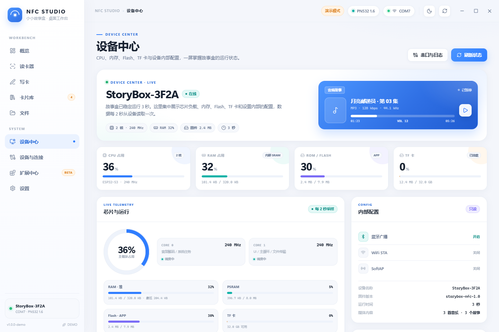

# 小小故事盒

基于 ESP32-S3 的儿童音乐播放器、故事机和视频机固件。设备使用 320×240 ST7789 屏幕、TF 卡、MAX98357A I2S 功放、EC11 旋钮和按键，带音乐 / 故事 / 视频 / 设置主页入口，支持音乐分类播放、MJPEG 视频全屏播放、故事插画跟随音频进度切换、亮度/旋转/EQ 设置。

当前版本新增 **NXP PN532 I2C 读卡** 与配套的 **Electron 桌面工作台**（`desktop/`）：可以检测读卡模块是否插入、实时展示射频卡信息，并把文本 / 链接写入 NTAG 标签。工作台还提供 **Windows 资源管理器风格的 TF 卡文件管理**，支持拖放 / 粘贴上传文件或文件夹。协议与接线见 [docs/pn532-i2c.md](docs/pn532-i2c.md)。

## 功能

- 主页：音乐 / 故事 / 视频 / 设置四个入口（车票卡片 + 主题插画），旋钮或 NEXT/LAST 移动焦点，OK 进入；开机固定回到主页。
- 音乐模式：按分类列表浏览 MP3（每页 4 行），进入分类后播放曲目，支持暂停、上一首、下一首和音量调节。
- 故事模式：`/story` 一级目录作为分类（如“音频故事 / 图文故事”）；分类内文件夹可继续递归下钻。图文故事以文件夹为最小单位；音频故事以文件夹中的**每一个 MP3** 为最小单位。播放页长按 NEXT 可查看当前目录的播放列表，并高亮正在播放的条目；音频故事播放页沿用音乐播放器的封面、进度和控制栏布局。
- 视频模式（当前 IDF 分支）：采用官方 `esp_player 1.1.1`，播放 `/video` 中的 MJPEG AVI 与内嵌 MP3 音轨；按音频时钟同步，解码与 UI 分核运行。支持暂停、上下个视频、音量、播放结束后 OK 重播。旧 QOI 和同名外挂音轨需要重新转换。迁移与上板验收见 [docs/idf-video-player.md](docs/idf-video-player.md)。
- 童锁：小程序开启后锁定实体按键和旋钮，手机端播放/音量控制不受影响；设备顶栏显示“童锁”，OK+NEXT 同时按住 5 秒可在本地解除（防止手机不在身边时锁死）。
- 设置：亮度、横屏方向、EQ、“刷新列表”，以及蓝牙广播 / WiFi / 热点 AP 三个无线开关。
- efont 中文点阵字体：标题和正文 16px，故事标题 14px，辅助信息 12px，按原生尺寸绘制。
- PSRAM 画布和局部提交：只把变化区域发送到屏幕，减少刷新闪烁和 SPI 传输。
- SD 媒体索引：首次启动或手动刷新时扫描文件，之后启动和页面切换直接读取索引（`/video` 不进索引，单独扫描）。
- 文件管理（上位机）：浏览 TF 卡、拖放/粘贴上传文件或文件夹、下载、新建文件夹、重命名、删除；支持复选框多选、批量移动和拖拽移动；上传/下载显示传输进度，移动/删除显示任务进度；上传到 `/music` 后会自动重建媒体索引。
- 设备中心（上位机）：通过 `sys · stats` 读取 CPU 占用、核心数与频率、RAM/PSRAM、Flash/ROM、TF 卡容量、播放器状态和全部内部设置；音量与亮度可直接写回设备（`sys · set`）。页面沿用上位机现有的蓝色主色、冷灰背景和白色卡片视觉。

“视频”入口的主题插画（128×128，生成后以 swap565 数组存在 Flash，运行时不解码 PNG）：


主页四格插画里，音乐/故事/设置取自 `docs/icons/home-scenes.png`（已烘焙进 `src/home_scenes.h`），视频格由 `tools/build_video_scene.mjs` 用代码绘制，输出 `docs/icons/video-scene.png` 和 `src/home_video_scene.h`。车票上的一排小图标由 `src/ui.cpp` 的 `homeTile()` 直接画，不依赖图片资源。

## 硬件

| 部件 | 接口/引脚 |
| --- | --- |
| ST7789 TFT | SCK 5，MOSI 4，DC 6，RST 7，CS 8，背光 9 |
| MicroSD | CLK 12，CMD 11，DAT0 13，1-bit SDMMC |
| MAX98357A | BCLK 16，LRC 17，DOUT 18 |
| OK / NEXT / LAST | 47 / 48 / 39 |
| EC11 编码器 | A 14，B 15，SET 21 |
| 霍尔开关 | 40 |
| I2C FRAM | SDA 1，SCL 2 |
| PN532 NFC | I2C SDA 1 / SCL 2，地址 0x24，3.3V |

完整引脚和设备限制见 [src/config.h](src/config.h)。当前限制为 300 首音乐、32 个音乐分类、128 个故事条目（音频故事的每个 MP3 都占一条）、64 个视频，每个故事最多 256 幅插画。

### 背光啸叫（PWM 调光）

背光是 IO9 上的 PWM（Q1 SS8050 驱动），频率默认 **25kHz**。之前用 5kHz 时，PWM 的负载纹波会调制 IP5306 的 5V 升压，某些亮度下电感/陶瓷电容会发出可闻啸叫；抬到 25kHz 后就落在人耳范围之外。

现场挑频率不用反复改代码：

```powershell
pio run -e bl-sweep -t upload      # 每 4 秒换一个频率，屏幕和串口显示当前值
```

听完把最安静的那个固定下来（[`platformio.ini`](platformio.ini) 的 `build_flags` 加一行，或直接用 `-DTFT_BL_FREQ=20000`）。

判断方法：**100% 亮度时 PWM 是常高、没有开关动作**——如果这时仍然啸叫，问题在 IP5306 轻载 PFM/升压本身（或 5V 上的 MLCC 压电效应），换调光频率无效，得从电源侧处理（加负载、改电感/电容、调整 IP5306 的轻载策略）。

## NFC 读卡与上位机

固件通过 I2C 连接 PN532（与 FRAM 共用 SDA/SCL），并在 USB CDC 上提供换行分隔 JSON 协议，供 `desktop/` 下的 Electron 上位机使用。

- 模块检测：PN532 在线状态、固件版本、I2C 地址；拔出/插入会自动上报。
- 读卡：UID、ATQA/SAK、卡片类型、容量、NDEF 记录、原始 Page/Block。
- 写卡：文本 / 链接 / 自定义 NDEF，自动写 CC 与 TLV，支持逐页回读校验。
- 高级：Type 2 原始页读写；MIFARE Classic 原始块读写（Key A）。
- 上位机：概览 / 读卡器 / 写卡 / 卡片库 / 文件 / 设备中心 / 设备与连接 / 扩展中心 / 设置，内置无硬件演示模式。




桌面端开发和打包：

```powershell
cd desktop
npm install
npm run dev        # 开发模式
npm run typecheck  # TypeScript 检查
npm test           # NDEF/卡片工具测试
npm run dist       # 生成 Windows NSIS 安装包
```

无硬件时可设置 `NFC_DEMO=1` 启动演示模式。上位机说明见 [desktop/README.md](desktop/README.md)，固件 I2C 驱动、串口协议和错误码见 [docs/pn532-i2c.md](docs/pn532-i2c.md)。

**本机启动方式**：安装包产物为 `desktop/dist/StoryBox-NFC-Studio-Setup-1.0.0.exe`，安装后从桌面/开始菜单快捷方式启动（快捷方式已带 `--no-sandbox`）。未安装时也可双击 [启动演示.cmd](desktop/启动演示.cmd) 或 [启动上位机.cmd](desktop/启动上位机.cmd)。当前受管环境里 Electron 必须带 `--no-sandbox` 才能启动，直接双击打包目录里的 exe 会在一闪而过后退出；安装器已处理快捷方式参数。

连接实体设备后的命令行冒烟测试（需要 `pyserial`）：

```powershell
python tools/nfc_smoke_test.py --port COM7 --text "月亮邮递员 · 第 03 集"
```

## 构建和烧录

需要 PlatformIO、Python 3 和可用的 PlatformIO 网络访问。

```sh
cd esp-story
python3 -m pip install --target /tmp/codex-platformio platformio
PYTHONPATH=/tmp/codex-platformio \
PLATFORMIO_CORE_DIR=/tmp/codex-platformio-core \
python3 -m platformio run
```

烧录和串口监视：

```sh
PYTHONPATH=/tmp/codex-platformio \
PLATFORMIO_CORE_DIR=/tmp/codex-platformio-core \
python3 -m platformio run --target upload

PYTHONPATH=/tmp/codex-platformio \
PLATFORMIO_CORE_DIR=/tmp/codex-platformio-core \
python3 -m platformio device monitor
```

固件目标为 `esp32-s3-devkitm-1`，串口速度为 115200，烧录速度为 921600。启动日志中应看到 `efontCN` 和 `PSRAM canvas: OK`。实际烧录需要连接 ESP32-S3 硬件；云端环境只能验证编译。

## TF 卡目录

音乐文件放在 `/music` 下。根目录中的 MP3 属于“全部歌曲”，一级子目录成为分类，子目录内的 MP3 会递归收录：

```text
/music/
  01.mp3
  1-2岁/
    小兔子.mp3
  3-5岁/
    森林.mp3
  儿歌/
    小星星.mp3
    拔萝卜.mp3
```

当前 IDF 分支的视频放在 `/video`：320×240 MJPEG AVI，MP3 音轨内嵌在同一个文件。旧 QOI 与外挂音轨不再作为播放方案；请从原始视频重新转码。ESP32-S3 没有 H.264 硬解，本项目推荐先转成 MJPEG：

```text
/video/
  小星星.avi        MJPEG + 内嵌 MP3
  拔萝卜.avi
```

电脑安装 ffmpeg（含 ffprobe）和 Node.js 后执行：

```powershell
# 默认 320x240、15fps、内嵌 MP3，输出到 ./out-video
node tools/build_video.mjs 小星星.mp4

# 批量转换；先以 15fps 上板验证，再尝试提高帧率
node tools/build_video.mjs --all-in .\素材 --out .\out-video --fps 15

# 校验容器、分辨率与编码（不代替上板性能验证）
node tools/verify_video.mjs .\out-video
```

只需将生成的 `.avi` 拷进 TF 卡的 `/video`。无声源和 `--no-audio` 会生成静音内嵌音轨，以保留同步时钟。工具不会删除卡上的旧外挂 MP3，但新播放器不会读取它们。

故事按 `/story` 的一级目录分组，推荐结构：

```text
/story/音频故事/睡前童话/
  01-小星星.mp3
  02-月亮船.mp3

/story/音频故事/系列/第二季/
  01-第二季故事.mp3

/story/图文故事/月亮邮递员/
  月亮邮递员.mp3
  01.jpg
  02.jpg
  timeline.lrc
```

音频故事目录中的每个 MP3 都是列表中的独立条目；图文故事目录（含 `timeline.lrc`）整体作为一条故事。分类下可以有多层子文件夹，长按 OK 逐级返回，播放页长按 NEXT 打开当前目录的播放列表。

`timeline.lrc` 的每行格式为：

```text
[00:00.00]01.jpg | 故事开始
[00:08.50]02.jpg | 月亮升起来了
```

可以使用 `tools/build_story.mjs` 将素材转换成 320×240 JPG、单声道 MP3 和设备时间轴。该脚本需要 Node.js 和 ffmpeg。

## 媒体索引

设备会在 SD 卡根目录生成 `/.esp-story-index.bin`。首次启动没有有效索引时扫描 `/music` 和 `/story`；以后直接加载索引，不再重复枚举目录。`/video` 不进索引：视频列表每次进入都重新扫描（通常几十个文件，开销很小），换视频不用刷新整卡。

增删、重命名或更换音乐/故事后，在设置中选择“刷新列表”，单击 OK 重新扫描并保存索引。刷新期间会停止播放，请勿拔出 TF 卡。索引包含版本和校验值，并使用临时文件及备份文件更新。详细行为见 [docs/media-index.md](docs/media-index.md)。

## 操作

| 操作 | 主页 | 音乐分类 / 歌曲 / 故事分类 / 故事列表 | 音乐播放页 | 故事播放页 | 视频列表 / 视频播放页 | 设置页 |
| --- | --- | --- | --- | --- | --- | --- |
| 旋转编码器 | 移动焦点 | 移动选择 | 调节音量 | 调节音量 | 列表: 移动选择 / 播放: 音量 | 调整当前项 |
| NEXT / LAST 短按 | 移动焦点 | 移动选择 | 下一首 / 上一首 | 同目录下一个 / 上一个故事 | 列表: 移动选择 / 播放: 下一个 / 上一个视频 | 上下选择 |
| NEXT / LAST 长按 | — | — | 歌曲列表 / 分类列表 | 当前目录播放列表 / 故事分类列表 | 播放页长按 NEXT: 暂停并看列表；长按 LAST: 停止回列表 | — |
| OK 单击 | 进入选中块 | 播放 / 进入 | 播放或暂停 | 暂停 / 继续 | 列表: 播放 / 播放页: 暂停或继续 | 递增当前项 |
| OK 双击 | — | — | — | — | — | 保存并回主页 |
| OK 长按 | — | 收藏（仅歌曲列表）/ 返回故事分类 | 停止并回分类列表 | 停止并回故事列表 | 停止并回视频列表 | — |
| SET 短按 | 进入选中块 | 播放选中项 | 播放或暂停 | 暂停 / 继续 | 播放 / 暂停 | — |
| SET 长按 | — | 回主页 | 回主页（音乐继续） | 停止并回主页 | 停止并回主页 | 保存并回主页 |

主页固定为“音乐 / 故事 / 视频 / 设置”四块。原来的“OK 双击进设置”和“SET 长按切换音乐/故事模式”已取消：设置只能从主页进入，返回主页统一用 SET 长按（设置页同时也是保存）。

在设置页使用 NEXT/LAST 选择项目，旋钮或 OK 修改；双击 OK 保存并回主页，长按 SET 也可以保存并回主页。设置页共 8 项，右侧滚动条表示当前窗口位置。

### 无线开关

| 设置项 | 行为 |
| --- | --- |
| 蓝牙广播 | 开：设备广播 `StoryBox-XXXX`，小程序可扫描/连接；关：停止广播（已建立的连接不受影响） |
| WiFi | 开：启用 WiFi STA，使用 `src/config.h` 中的 `WIFI_STA_SSID` / `WIFI_STA_PASS` 连接；未配置时只打开射频 |
| 热点 AP | 开：启动 SoftAP，SSID `StoryBox-XXXX`，密码 `storybox123`，默认地址 `192.168.4.1` |
| 显示绑定码 | 在屏幕上显示 6 位首次配对码，双击 OK 返回 |

WiFi 与 AP 可同时开启（AP+STA）。三个无线开关都会写入 FRAM，重启后保持。默认：蓝牙广播开，WiFi/AP 关。

首次绑定码保存在 FRAM，未绑定设备开机时显示 4 秒；手机连接时也会自动切到绑定码页，方便在小程序里输入。绑定成功后不再显示。

## 项目结构

```text
src/display.*       ST7789、PSRAM 画布和局部提交
src/ui.*            页面绘制和 UI 状态缓存
src/fonts.*         efont 点阵字体选择
src/player.*        ESP32-audioI2S 和音频 FreeRTOS 任务
src/storage.*       音乐列表和分类
src/story.*         故事目录、时间轴和插画切换
src/video.*         /video 扫描、AVI 索引、按时间轴取帧（QOI / MJPEG）
src/video_timing.h  帧时间轴换算（纯函数，可主机端单测）
src/catalog.*       SD 媒体索引加载、扫描和保存
src/parental.*      家长控制、用量、音量范围、白名单、PIN、绑定
src/ble.*           BLE GATT 服务、JSON 协议、广播开关
src/network.*       WiFi STA / SoftAP 开关
src/pn532.*         PN532 I2C 驱动：帧校验、寻卡、Type 2 页 / Classic 块读写
src/nfc.*           NFC 业务层：卡片模型、NDEF 写入状态机、事件队列
src/hostlink.*      USB CDC 上位机 JSON 协议（请求/响应/事件）
src/home_scenes.h   主页音乐/故事/设置三格 128x128 swap565 插画
src/home_video_scene.h 主页视频格插画（tools/build_video_scene.mjs 生成）
desktop/            Electron + React + TypeScript 上位机
tools/              视频转码/校验、故事时间轴、字体与主页素材、BLE 冒烟测试
test/               主机端索引、渲染与视频时间轴测试
docs/               刷新、索引、字体对比、PN532 协议和上位机截图
```

## 验证

固件构建：

```sh
PYTHONPATH=/tmp/codex-platformio \
PLATFORMIO_CORE_DIR=/tmp/codex-platformio-core \
python3 -m platformio run
```

主机端逻辑测试：

```sh
g++ -std=c++11 -Wall -Wextra -pedantic -fsanitize=address,undefined \
  test/render_math_test.cpp -o /tmp/esp-story-render-test
/tmp/esp-story-render-test

g++ -std=c++11 -Wall -Wextra -pedantic -fsanitize=address,undefined \
  test/video_timing_test.cpp -o /tmp/esp-story-video-test
/tmp/esp-story-video-test

g++ -std=c++11 -Wall -Wextra -pedantic -fsanitize=address,undefined \
  -Itest/catalog_host -Isrc src/catalog.cpp test/catalog_host/test_catalog.cpp \
  -o /tmp/esp-story-catalog-test
/tmp/esp-story-catalog-test
```

视频转码/检查（需要 Node.js 和 ffmpeg，不需要硬件）：

```powershell
node tools/build_video.mjs --all-in .\素材 --out .\out-video --fps 20
node tools/verify_video.mjs .\out-video
node tools/selftest_video.mjs      # QOI 编解码 + AVI 封装的往返自测
```

NFC 上位机：

```powershell
cd desktop
npm install
npm run typecheck
npm test
npm run build
```

当前已验证固件编译、上位机类型检查、NDEF 单元测试、Electron 演示模式端到端流程和 Windows 打包启动；视频转码链路、QOI 编解码往返和 AVI 封装/索引已用样片与自测脚本验证（`tools/selftest_video.mjs`、`tools/verify_video.mjs`）。真实屏幕上的视频帧率、A/V 同步和 PN532 的 I2C 时序仍需连接硬件验收。

显示刷新方案和硬件验收项目见 [docs/display-refresh.md](docs/display-refresh.md)；字体方案对比见 [docs/font-comparison.html](docs/font-comparison.html)；视频播放原理、AVI 结构和转码参数见 [docs/video-playback.md](docs/video-playback.md)。

## 当前限制

- JPEG 解码和媒体刷新仍在主任务中执行，故事切图的实际流畅度需要硬件验证。
- PSRAM 画布减少了中间态和无效传输，但不保证整屏切换完全无撕裂。
- 媒体索引不会自动发现新增文件，修改音乐/故事后必须手动刷新；`/video` 每次进入列表时重新扫描，不受索引影响。
- 视频只支持帧内编码的 AVI：**QOI（默认，软解最快）或 MJPEG**；不能直接放 MP4/H.264，必须先用 `tools/build_video.mjs` 转换。ESP32-S3 没有 H.264 硬解，Espressif 官方 `esp_h264` 软件解码在 S3 上的上限只有 320×240@19fps（约 52ms/帧），比 MJPEG 还慢，且参考帧依赖导致落后时不能丢帧。
- QOI 体积约为 MJPEG 的 3~5 倍（卡通素材实测 6.9KB/帧 → 31KB/帧），换来解码从约 20~35ms/帧降到 3~6ms/帧；12fps 时约 0.4MB/s，20fps 约 0.6MB/s，仍在 1-bit SD 的承受范围内。
- 视频音轨是独立文件（同名 `.mp3`/`.wav`），AVI 内嵌音轨不会被读取；脚本会自动生成，漏放音轨时静音播放。
- 视频没有拖动进度条/跳转，只有暂停、上下一个、停止；播放结束后自动播下一个。
- 视频按固定帧间隔播放，解码或推屏跟不上时丢帧保证音画同步；SPI 40MHz + 320×240 实测预期 10~15fps，具体以硬件为准。
- 主页四个入口为音乐/故事/视频/设置；开机固定回主页，不再自动载入并暂停上次曲目（音量、上次音乐分类的光标仍会恢复）。
- 故事按 `/story` 的一级文件夹分组，分类内支持多层子文件夹；图文故事以文件夹为单位，音频故事以每个 MP3 为单位，最多 128 个故事条目。家长故事白名单仍限制前 64 条。
- 没有连接实体硬件时无法验证屏幕颜色、按键方向、音频爆音和真实帧率。
- PN532 驱动与上位机协议已完成编译和模拟验证；真实 I2C 时序、不同 NTAG 容量、Classic 密钥与写入回读需要现场硬件验收。
- PN532 目前只支持 ISO 14443A；MIFARE Classic 仅支持原始块读写，不支持 NDEF/MAD；DESFire 等 14443-4 卡片仅识别 UID。
- I2C 与 FRAM 共用总线，NFC 操作全部在主循环串行执行；写入时按页分步，避免长时间阻塞 UI。
