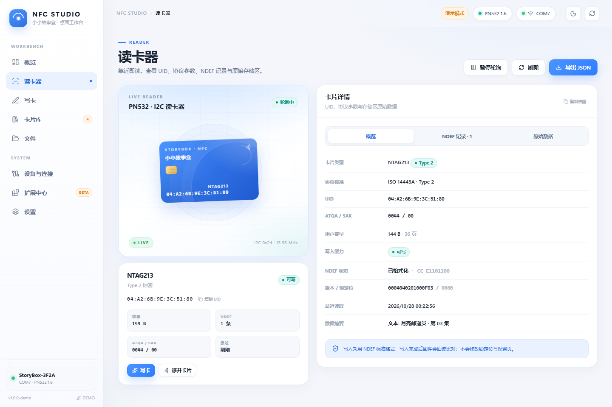
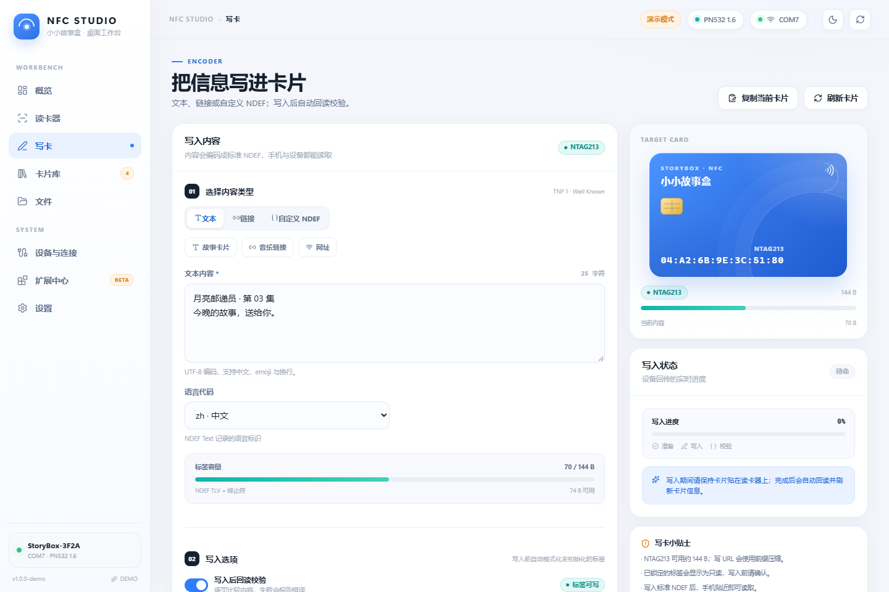
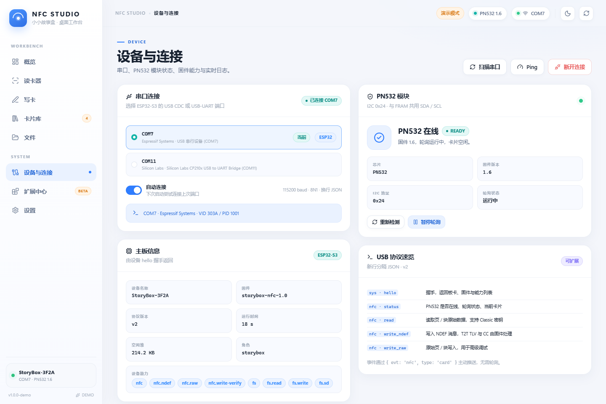

# StoryBox NFC Studio

小小故事盒的 PN532 NFC 桌面工作台。Electron + React + TypeScript，通过 USB CDC 与 ESP32-S3 固件通信。

界面配色参考 `C:\code\SMALL_WX` 小程序首页设计：蓝色主色、冷灰背景、白色卡片和轻阴影，避免大面积深色块。


## 功能

- **模块检测**：自动识别串口，上报 PN532 是否在线、固件版本、I2C 地址与轮询状态。
- **读卡**：UID、ATQA/SAK、卡片类型、容量、NDEF 记录、原始 Page/Block 数据。
- **写卡**：文本、链接、自定义 NDEF；自动计算容量、写入进度、回读校验。
- **高级写入**：Type 2 原始 Page、MIFARE Classic 原始 Block（Key A）。
- **卡片库**：本机保存最近 50 张卡片快照，支持搜索、筛选、JSON 导出。
- **文件管理**：Windows 资源管理器风格界面，浏览 TF 卡、拖放/粘贴上传文件或文件夹、下载、新建文件夹、重命名和删除；支持复选框多选、批量移动，以及拖拽移动文件/文件夹。上传/下载在传输面板显示进度，移动/删除在资源管理器底部显示任务进度。
- **设备页**：串口列表、连接/断开、PN532 排查清单、实时串口日志、协议速览。
- **扩展中心**：模块化架构说明与后续能力插槽。
- **演示模式**：无硬件时自动连接模拟设备，完整走通读卡/写卡/历史流程。
- **无边框窗口**：隐藏原生标题栏/菜单栏，自绘最小化、最大化/还原和关闭按钮；顶部空白区域和侧栏品牌区可拖动窗口。

## 快速开始

要求：Node.js 20+（推荐 22/24）、Windows 10/11。

**本机推荐双击这两个脚本启动**（会绕过 SmartScreen，并自动加 `--no-sandbox`）：

- [启动演示.cmd](启动演示.cmd)：无硬件，使用模拟 NTAG213 走通读写流程。
- [启动上位机.cmd](启动上位机.cmd)：连接真实 PN532。

从源码运行：

```powershell
cd desktop
npm install
npm run dev
```

没有连接硬件时，可在启动前打开演示模式：

```powershell
$env:NFC_DEMO = "1"
npm run dev
```

也可以直接启动已构建的 Electron 产物：

```powershell
npm run build
npm start
```

打包后可双击 `启动演示.cmd` / `启动上位机.cmd`（源码目录），它们会带 `--no-sandbox` 启动。正式安装后请使用桌面/开始菜单快捷方式，安装器已经给快捷方式预置了 `--no-sandbox`。

### 打包

```powershell
npm run build
npm run dist
```

产物：

- `dist/StoryBox-NFC-Studio-Setup-1.0.0.exe`：**NSIS 安装包**，可以选择安装目录，自动创建桌面和开始菜单快捷方式。
- `dist/win-unpacked/`：免安装目录版，调试用。
- 可选：`npm run dist:portable` 生成单文件便携版（本机受管环境不推荐）。

安装器创建：

- 桌面快捷方式 `StoryBox NFC Studio`；
- 开始菜单 `StoryBox NFC Studio`（含“演示”快捷方式）；
- 快捷方式参数为 `--no-sandbox`，否则本机 Electron 会一闪而过；
- `runAfterFinish` 已关闭，安装完成后请从快捷方式启动。

如果 AppData 被安全软件限制，可以指定一个可写目录：

```powershell
$env:NFC_USER_DATA_DIR = "D:\StoryBoxData"
.\dist\win-unpacked\"StoryBox NFC Studio.exe" --no-sandbox
```

## 使用流程

1. USB 连接 ESP32-S3（固件需包含 `hostlink.cpp`，见 [`docs/pn532-i2c.md`](../docs/pn532-i2c.md)）。
2. 打开上位机 → **设备与连接** → 选择 `COMx`（Espressif / CP210x / CH340）→ 连接。
3. 确认顶部出现 `PN532 1.6`，模块卡片显示“在线”。
4. 把 NTAG 卡片放到 PN532 线圈上方 2–3 cm。
5. **读卡器**页查看 UID、NDEF 与原始数据；**写卡**页写入文本或链接。
6. 写入完成后会自动回读校验并刷新卡片；失败时右侧会显示错误码和提示。
7. **文件**页可以像资源管理器一样浏览 TF 卡：把 Windows 文件/文件夹拖进页面，或复制后按 `Ctrl+V`；勾选左侧复选框可多选，点顶部“移动”选择目标文件夹，或直接把选中项拖到文件夹/面包屑上。右键可下载、重命名、删除。上传到 `/music` 后会自动重建媒体索引。

> 文件管理需要包含 `src/filexfer.cpp` 的新固件；旧固件连接后会提示“当前固件不支持文件管理”。协议见 [docs/pn532-i2c.md](../docs/pn532-i2c.md#38-tf-卡文件管理fs)。

## 界面

| 页面 | 预览 |
| --- | --- |
| 文件 |  |
| 读卡器 |  |
| 写卡 |  |
| 设备与连接 |  |

## 架构

```text
src/main/
  index.ts        Electron 主进程、窗口、IPC 注册
  serial.ts       NfcSession：串口打开/握手/请求响应/心跳/重连/事件/文件传输
  settings.ts     连接偏好持久化（userData/settings.json）

src/preload/
  index.ts        contextBridge 暴露类型化 window.nfcBridge（含 files API）

src/renderer/src/
  App.tsx         应用壳、路由、启动初始化
  store/          Zustand 全局状态（连接/卡片/历史/日志/写入）
  lib/            NDEF 编解码、卡片格式化、演示设备（含内存 TF 卡）、主题、存储
  components/     Sidebar/TopBar/NFC 扫描器/卡片/NDEF/Hex/Toast
  pages/          概览/读卡器/写卡/卡片库/文件/设备/扩展/设置
```

### 传输层

`NfcSession` 负责：

- 串口枚举与“像开发板”的端口排序（Espressif、CP210x、CH340/CH910、FTDI）。
- 打开串口 → 每 300ms 发送 `sys.hello` → 收到 `hello/boot` 后进入 connected。
- 请求 id 与响应匹配、5s 心跳、3 次心跳失败自动重连。
- 将非 JSON 的设备日志原样送到 UI 日志面板。
- 事件：`conn:status`、`device:event`、`log:entry`。
- 文件传输：`fs.list/mkdir/remove/rename/read/write/rescan`，内容 base64 分块；下载写入本机文件，上传支持浏览器拖放和 Windows 剪贴板路径（含文件夹）。

### 协议

换行分隔 JSON v2；详细命令见 [`docs/pn532-i2c.md`](../docs/pn532-i2c.md#3-usb-串口协议v2)。

```json
{"v":2,"id":3,"cmd":"nfc","act":"status"}
{"v":2,"evt":"nfc","type":"card","card":{...}}
```

### 为什么要做扩展层

- 设备能力通过 `features` 列表上报，UI 可以按能力显示/隐藏入口。
- 页面只依赖 `useAppStore` 与 `NfcBridge`，不直接碰 Electron/串口。
- 新增一个设备模块只需：固件 `features.add(...)` + 主进程 IPC + 一个页面/Meta 项。
- 演示设备与真实串口共用同一 `NfcBridge` 接口，方便无硬件开发和视觉验收。

## 开发命令

```powershell
npm run dev        # 开发模式（Electron + Vite HMR）
npm run build      # 构建 main/preload/renderer
npm start          # 预览已构建产物
npm run typecheck  # TypeScript 严格检查
npm test           # NDEF/卡片工具单元测试（Vitest）
npm run dist       # Windows NSIS 安装包
npm run dist:portable  # 可选：单文件便携版
```

## 测试与验收

当前已验证：

- `npm run typecheck` 通过。
- `npm test`：15 个 NDEF / TLV / 卡片解析测试通过。
- Chromium 端到端：演示模式自动连接 → 展示 NTAG213 → 写入文本 → 读卡器显示新 NDEF → 原始数据分页 → 卡片库弹窗 → 深色主题，无控制台错误。
- Electron 45 实际启动（Playwright `_electron`）：preload/IPC、`window.nfcBridge`、渲染页、打包后的 `win-unpacked` 均可用。
- 串口异常路径：连接不存在的 `COM99` 返回可读错误并在界面显示。
- NSIS 安装包已构建，安装器会创建带 `--no-sandbox` 的桌面/开始菜单快捷方式；受管环境首次运行仍可能被安全软件扫描。

需要实体硬件验证：真实 PN532 I2C 读写、不同 NTAG 容量、Classic 密钥、长时间轮询稳定性。详见 [`docs/pn532-i2c.md`](../docs/pn532-i2c.md#5-构建与验证)。

## 常见问题

**Q: 双击安装后的程序或开发目录里的 exe 没有任何反应 / 进程一闪而过？**
A: 这是本机受管环境对 Electron 沙箱的限制：Chromium 在加载应用 JS 之前就会崩溃，日志里表现为 `c0000005`，所以双击 exe 不会出现窗口。必须带 `--no-sandbox` 启动。正式安装后请使用桌面/开始菜单快捷方式（安装器已带参数）；源码目录请使用 `启动演示.cmd` / `启动上位机.cmd` / `run-demo.cmd` / `run.cmd`。

```bat
start "" "dist\win-unpacked\StoryBox NFC Studio.exe" --no-sandbox
```

**Q: 双击安装包或安装后的程序出现“Windows 已保护你的电脑 / Microsoft Defender SmartScreen 阻止了无法识别的应用启动”？**
A: 这是因为 exe 没有代码签名证书，属于未知发布者，不代表应用有病毒。可以任选一种方式：

1. 点击弹窗的 **“更多信息” → “仍要运行”**；Windows 会记住这个文件。
2. 安装完成后从桌面/开始菜单快捷方式启动；快捷方式目标已带 `--no-sandbox`。
3. 右键 exe → **属性** → 勾选 **“解除锁定”** → 应用；或运行 `UNBLOCK.ps1` 批量移除下载标记。

如果安装器被安全软件直接拦截，请先允许/恢复该文件，或使用源码目录的 `启动演示.cmd` / `启动上位机.cmd`。

**Q: 启动时控制台出现 `GPUPersistentCache` / `Network` 访问被拒绝？**
A: 某些受管 Windows 环境会限制 Chromium 子进程写 AppData。应用会自动使用内存 profile 继续运行；可设置 `NFC_USER_DATA_DIR` 到可写目录消除该提示。

**Q: 界面显示“演示模式”但我想连真机？**
A: 在设置里关闭演示模式，或在启动时不要设置 `NFC_DEMO=1` / `--demo`。

**Q: 串口打开失败？**
A: 关闭 Arduino 串口监视器、其它串口工具；确认 USB 线支持数据；重新插拔后再扫描。

**Q: 写入提示 `READ_ONLY` / `VERIFY`？**
A: 标签锁定或质量差；换一张可写 NTAG，保证写入时卡片不动。详见协议文档的错误码表。
