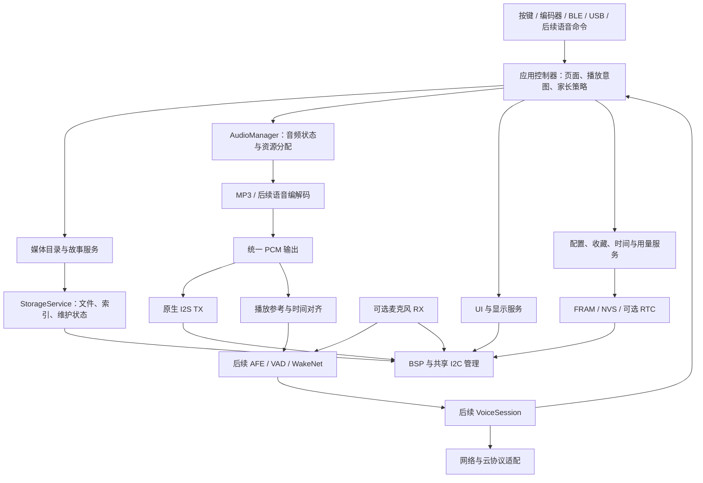
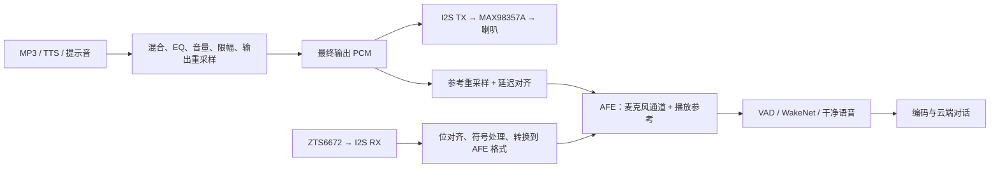

# ESP32-S3 故事机全量迁移至 ESP-IDF 的实施计划

编制日期：2026-10-28  
工程目录：`esp-ccc`  
目标平台：ESP32-S3-WROOM-1U-N16R8  
当前框架：PlatformIO + Arduino ESP32  
文档状态：迁移实施建议；本文未执行源码迁移、烧录或硬件测试。

实施校正（2026-10-29）：当前迁移基线 `988ed5f` 的 USB/桌面端已经使用
`SBX4` 二进制帧和 JSON v4，本文下面的 USB JSON v2 描述已过时。
迁移以实际源码中的 v4 字段、CRC 和原始数据块为兼容目标；实施状态见
[迁移实施记录](idf-migration-progress.md)。

## 1. 迁移目标与范围

建议现在启动迁移，最终交付一个**不依赖 Arduino Core 运行时的 ESP-IDF 主工程**。保留已经实现的故事机业务、显示资源、媒体格式和桌面端协议，重构底层驱动、资源管理与跨任务通信，并为后续单麦 AI 对话建立可扩展的音频链路。

“全量迁移”描述的是最终状态。实施仍应分阶段推进，每个阶段都有可运行固件、验收记录和恢复方法，避免所有模块同时失去可验证性。

### 1.1 必须完成的迁移范围

| 范围 | 迁移完成后的要求 |
| --- | --- |
| 构建与启动 | 使用 ESP-IDF、CMake、`app_main()`、`sdkconfig.defaults`；依赖版本可复现 |
| 本地音频 | 音乐、童谣、纯音频故事、图文故事正常播放；保留暂停、切歌、自动下一曲、音量和 EQ |
| 显示与交互 | 保留现有页面、中文字体、图标、编码器、按键、霍尔显示、童锁操作 |
| 媒体与状态 | 保留 TF 卡目录结构、媒体索引、收藏、分类选择、曲目记忆和家长策略 |
| 外部通信 | 保持 USB JSON v2、BLE 现有协议、NFC 读写、桌面文件管理可用 |
| 网络与电源 | 迁移 STA/AP 控制、熄屏、休眠和唤醒，建立网络与任务生命周期管理 |
| 系统可靠性 | 统一错误处理、诊断、停止确认、持久化失败处理；建立应用 OTA 与回滚基础 |
| AI 扩展底座 | 统一音频输出所有权；支持采集端接入、播放参考、取消请求、能力声明和资源预算 |

### 1.2 与迁移分开验收的新增功能

以下功能应在架构中预留，但不能算作当前已存在、只需换框架的功能：

- 麦克风录音、唤醒词、VAD、AEC、ASR/LLM/TTS 云端对话。
- 持续监听、边播边听、语音打断和多轮对话。
- NFC 卡片自动触发某首歌曲或某个故事。
- Wi-Fi 配网产品流程、云端账户和在线媒体库。
- 新网表上的 RTC、EEPROM、功耗监测器件的完整业务功能。
- 从播放秒数恢复、媒体身份系统升级、UI 改版。

其中，若目标板确实使用新 FRAM，**适配它是迁移必需项**；启用 RTC 日历、显示电量等属于可单独交付的新增硬件功能。

### 1.3 技术选型结论

1. **原生 ESP-IDF 作为目标底座。** 以 5.5.x 为首选评估系列，在阶段 M0/M1 锁定一个通过依赖验证的具体补丁版本。本文不把“某个组件支持 IDF 5.x”视为整个依赖组合已通过验证。
2. **继续使用 C++。** 不要求把业务改写成 C，也不要求放弃独立于 Arduino 的第三方库。
3. **优先保留 LovyanGFX 和 ArduinoJson。** 本地 LovyanGFX 已有 ESP-IDF 构建入口；ArduinoJson 的核心解析能力可在标准 C++ 中使用。仍须核对实际使用的文件、字符串、流接口。
4. **替换当前 ESP32-audioI2S 播放封装。** 优先验证独立 MP3 解码组件加原生 I2S channel API，避免后续采集与旧 I2S 驱动冲突。
5. **不把 LVGL、完整 ESP-ADF 或小智整套应用框架作为迁移前置条件。** 它们只有在具体需求证明收益时才引入，避免同时更换 UI、业务框架和音频底座。
6. **Arduino Component 仅作为隔离验证的备选手段。** 它不是本文的最终交付形态，也不能用它掩盖旧驱动与新驱动冲突。官方提供该过渡路径，并规定了 Core/IDF 版本和 tick 配置约束。[cite:1](#ref-1)

### 1.4 事实与建议的区分

本文中的“代码现状”来自当前工作区读取；“网表现状”来自 `Netlist_Schematic1_1_2026-10-28.enet`，不代表对应元件已实际焊接。第三方能力以官方文档或项目源码为依据，属于单一官方来源的 API 说明，尚未在本工程交叉实测。

迁移阶段、工期、缓冲容量和验收阈值属于工程建议，不是已测结果。前序分析中的 Arduino 编译通过，也不能证明原生 IDF 版本的兼容性。

## 2. 当前工程基线与硬件差异

### 2.1 必须保留的实际行为

应以源码和旧设备实际表现建立验收基线，不能直接以 README 作为唯一规格。

| 模块 | 当前实际能力或行为 | 迁移时需要保留的细节 |
| --- | --- | --- |
| 音乐 | `/music` 根目录及分类内 MP3；分类内递归收录 | 浏览列表与正在播放的列表分开管理 |
| 童谣 | 按分类名称识别童谣、儿歌等内容 | 浏览童谣不应提前切换当前播放列表 |
| 故事 | 最多三层目录扫描；目录内 MP3；可选 LRC 图片时间轴 | 纯音频与图文故事分别处理 |
| 故事同步 | 根据播放进度选择 JPEG | 目前按整数秒更新，不是毫秒精度切图 |
| 音频任务 | Core 0 独立任务、优先级 2、队列与状态快照 | 保留单一音频所有者思想，不照搬优先级和绑核作为最终性能结论 |
| 启动恢复 | 有记忆时加载曲目并暂停，可直接进入播放页 | 当前不恢复上次播放秒数 |
| 显示 | 320×240、PSRAM 画布、变化条带提交 | 保留 RGB565 字节序、旋转、DMA 缓冲生命周期 |
| 设置 | 实际为 10 项 | 亮度、旋转、EQ、熄屏、休眠、刷新、BLE、Wi-Fi、AP、绑定码 |
| 家长控制 | 日额度、休息时段、音量范围、白名单、远程锁、童锁 | 策略由设备执行，不能依赖手机在线 |
| BLE | 绑定、鉴权、校时、配置、内容查询、播放控制、状态通知 | JSON 行分包和 MTU 分片行为 |
| USB/NFC | JSON v2、状态事件、卡片读取、NDEF 与原始区写入 | NFC 当前作为工作台使用，没有卡片到媒体的自动映射 |
| TF 文件管理 | 上传、下载、目录操作、取消、媒体重建 | 4096 字节块、重试和重复 offset 处理 |
| Wi-Fi | STA/AP/AP+STA 开关 | 当前未实现云服务和完整配网 |
| 电源 | 播放空闲熄屏，无播放时深睡 | 编码器 RTC GPIO 唤醒，深睡后重新启动 |

### 2.2 新网表与固件已经不一致

这一差异必须在迁移开始前处理，否则容易把硬件版本问题误判为 ESP-IDF 驱动问题。

| 项目 | 当前代码 | 2026-10-28 网表 | 对迁移的影响 |
| --- | --- | --- | --- |
| FRAM | MB85RC16 寻址方式：高地址位进入 `0x50～0x57`，发送一个字节的内部地址 | U15 为 FM24CL64B，A0 接 3V3，A1/A2 接 GND | 新板应使用预期 7 位地址 `0x51` 和两个地址字节，不能机械替换 `Wire` API |
| EEPROM | 无独立驱动 | U13 为 AT24C512CDRG，地址脚均接 GND | 预期地址 `0x50`；旧 FRAM 探测可能把它的 ACK 当成 FRAM 存在 |
| RTC | 没有 RTC 驱动，时间来自软件校时 | U12 为 FRTC8900CE | 应建立可选 RTC 时间源；未实贴或未验证时保留软件校时降级 |
| 功放使能 | `config.h` 仅有 BCLK/LRCLK/DOUT | MAX98357A `SD_MODE#` 接 GPIO38 | 新 BSP 必须描述该引脚；验证使能电平与声道选择含义 |
| USB 电源状态 | 未使用 | GPIO42 接 `USB_PRESENT_N`，来自 TPS2116 ST | 可作为后续电源状态输入，不能未经时序核对等同于完整 USB 会话状态 |
| 额外外设信号 | 未使用 | GPIO41 接 `OUT1` | 需核实外设用途，不能分配给麦克风 |
| 功耗监测 | 未使用 | U14 为 INA226 | 按可选设备处理；电流换算需要采样电阻与校准信息 |
| SD 卡检测 | 宏把 GPIO10 标为低有效卡检测 | 连接到 TF 卡的 CD/DAT3 引脚 | 不应直接按独立机械插拔检测开关使用 |
| 麦克风 | 无 | 此网表未见 ZTS6672 麦克风器件 | AI 录音验收需要后续板卡或外接模块 |

FM24CL64B 的容量为 8192 字节，内部地址使用两个字节，器件地址由 A2/A1/A0 选择；由网表可推导出 `0x51`。该推导基于器件系列官方手册，实贴后仍要按实际料号和线路确认。[cite:2](#ref-2)

**最危险的迁移方式，是保留旧 `devAddr()` 逻辑，仅把 `Wire` 改成 IDF I²C API。** 这会产生错误器件选择和错误地址帧。ACK 只能证明地址上有设备，不能证明设备类型正确；本文未进行实机访问，不能断言当前已经发生数据损坏。

M0 应建立至少两类明确的板级配置：

- `legacy`：对应现有固件实际验证过的旧板，具体 FRAM 型号需与实物确认。
- `rev_20261028`：按新网表生成候选配置，再与实物核对。

板型应由构建配置或可靠板型标识选择，不通过“哪个地址 ACK 了”猜测。型号、容量、内部地址长度和引脚缺省值使用具名字段描述。

### 2.3 迁移时不能误认为已解决的问题

- `Player::enqueue()` 当前允许队列满时丢命令；增加网络和语音控制后不能继续依赖“用户操作不会那么快”。
- `Pn532::busRecover()` 会直接关闭并重建全局 `Wire` 总线；多任务下可能破坏 FRAM、RTC 等设备的在途操作。
- `Power::deepSleepNow()` 当前通过异步停止加固定延时收尾；迁移后应等待资源释放确认。
- FRAM 写接口没有成功/失败返回值，上层可能在实际写失败时仍更新“已保存”状态。
- 音乐 ID 是文件名的 FNV 散列；收藏是全量曲目下标位图；分类和故事白名单也依赖索引位置。
- 文件上传当前直接写目标文件，不具备完整的临时文件提交保护。
- 设置、故事目录、开机行为等文档描述已落后于代码。
- 桌面演示开关的持久化与桥接选择存在既有衔接问题，应单独登记，不用演示模式替代真实设备验收。

这些问题不全部属于迁移阻塞项。资源所有权、停止确认、数据写入结果和板型错配需要随迁移修正；身份体系升级、演示开关、交互调整可作为独立变更。

## 3. 目标架构与模块边界

### 3.1 推荐架构



核心约束是：**业务提出意图，服务管理资源，驱动只处理硬件。** 不建立多个都能直接调用 I2S、关闭 SD 或重置 I²C 总线的“管理器”。

### 3.2 建议目录

下面是目标组织方式，不要求在首个提交一次性生成所有目录：

```text
esp-ccc/
├── CMakeLists.txt
├── sdkconfig.defaults
├── sdkconfig.defaults.esp32s3
├── partitions.csv
├── dependencies.lock
├── main/
│   ├── CMakeLists.txt
│   ├── idf_component.yml
│   └── app_main.cpp
├── components/
│   ├── board/          # 板型、引脚、外设能力、共享总线
│   ├── audio/          # AudioManager、解码、PCM、I2S、参考信号
│   ├── storage/        # SD、文件操作、目录和媒体索引
│   ├── media/          # 音乐/童谣/故事业务
│   ├── ui/             # LovyanGFX、页面、字体和图标
│   ├── input/          # GPIO、编码器、按键语义
│   ├── settings/       # FRAM、配置、收藏、会话记录
│   ├── parental/       # 权限、日额度、时间策略
│   ├── connectivity/   # Wi-Fi、BLE、USB transport
│   ├── hostlink/       # JSON v2、文件服务路由
│   ├── nfc/            # PN532 帧、卡片与写入状态机
│   ├── system/         # 生命周期、电源、诊断、OTA
│   └── voice/          # 后续 AI 会话与云协议
├── desktop/            # 保留 Electron 工程
├── tools/              # 保留媒体制作与设备验证工具
└── docs/
```

不为每个小函数建立组件。先把硬件、音频、存储和应用层分开，再根据依赖关系调整颗粒度。第三方组件不直接修改生成的依赖目录；必要补丁应固定版本并单独记录。

### 3.3 统一的资源所有权

| 资源 | 唯一负责方 | 其他模块如何使用 |
| --- | --- | --- |
| I2S TX/RX、采样率、DMA 生命周期 | AudioManager 及其内部任务 | 提交播放、采集、停止等具名请求 |
| SD 挂载与卸载、维护状态 | StorageService | 通过文件访问许可与明确的句柄生命周期 |
| 媒体目录快照 | 媒体服务 | 使用版本化快照；重建时不暴露半成品 |
| I²C 总线创建与恢复 | Board I2C 服务 | 设备驱动持有受管句柄，不私自重装总线 |
| UI 对象与绘图 | UI 任务 | 消费状态快照，不接受其他任务直接绘图 |
| USB 输出 | Host transport TX 任务 | 协议响应与日志分别入队，完整帧串行发送 |
| 家长配置与播放授权 | 应用控制器/家长策略服务 | 本地、BLE、USB、AI 都走同一授权入口 |
| 深睡、OTA、重启 | 生命周期服务 | 统一请求各服务停止并确认 |

全局配置尽量在初始化时构造完成。队列中的数据必须拥有有效生命周期，不能传临时 `c_str()`、解析器内部指针或即将重建的曲目对象地址。

### 3.4 Arduino API 的替换原则

| 当前依赖 | 目标处理 |
| --- | --- |
| `setup()` / `loop()` | `app_main()` 初始化；应用、UI、协议等任务按职责运行 |
| `millis()` | 统一单调时钟接口，内部可用 `esp_timer_get_time()`；边界明确毫秒/微秒 |
| `delay()` | 可让出 CPU 的任务等待或事件等待；保留必要硬件时序 |
| `pinMode()` / `digitalRead()` / `digitalWrite()` | 原生 GPIO API |
| `attachInterrupt()` / `noInterrupts()` | GPIO ISR 与合适的 FreeRTOS 临界区/同步机制 |
| `ledcSetup()` / `ledcAttachPin()` | IDF LEDC timer/channel 配置 |
| `Wire` | IDF 新 I²C master bus/device API |
| `SD_MMC` / Arduino `File` | SDMMC + FATFS/VFS；使用受控的文件封装 |
| `Serial` | USB Serial/JTAG transport；日志经统一输出策略处理 |
| `WiFi` | `esp_netif`、`esp_event`、`esp_wifi` |
| `NimBLE-Arduino` | ESP-IDF NimBLE host 与 GATT 服务 |
| Arduino `String` | 业务层按需要使用 `std::string` 或有界字符串，明确 UTF-8 字节长度 |
| ArduinoJson | 保留核心 JSON 能力，删除对 Arduino Stream 等接口的依赖 |

不同 IDF API 的 timeout 单位并不完全相同，不能把所有数值统一套一次 `pdMS_TO_TICKS()`。应用层建议使用明确命名的 `timeout_ms`，仅在驱动边界转换。

## 4. 各功能的迁移处理、难点与易错点

### 4.1 构建、启动和系统配置

**处理方式：重建底座，逐项接回业务。**

1. 建立最小 ESP-IDF 工程，明确 `esp32s3` 目标、16 MB Flash 和对应 Octal PSRAM 配置。
2. 从模组型号与启动日志双向确认实际 Flash/PSRAM，不依赖通用开发板配置的默认容量。
3. 固定 IDF、工具链、LovyanGFX、ArduinoJson、解码器和 ESP-SR 验证版本。
4. 建立开发、发布、硬件诊断配置；诊断代码不能改变正常产品默认行为。
5. `app_main()` 只负责依赖有序初始化及任务启动，避免重新长成一个包含全部业务的入口函数。
6. 初始化失败区分必需与可选：PSRAM/关键音频内存失败需要明确降级；PN532 未连接不应阻塞设备启动。
7. 不在全局对象构造函数中启动 I²C、I2S、网络或创建依赖尚未就绪的任务。

**易错点：**

- Arduino 构建宏不等同于 IDF `sdkconfig`。
- C++ 异常、RTTI、标准版本与库要求不一致。
- `pdMS_TO_TICKS(1)` 在某些 tick 配置下为 0，可能导致忙轮询；纯 IDF 不需要为了保留 `delay(1)` 而盲目固定 1000 Hz。
- ESP-IDF 的 FreeRTOS 任务栈参数习惯与其他 FreeRTOS 平台可能不同，应按实际 API 单位检查。
- 构建通过但依赖仍暗中链接 Arduino，不能算脱离 Arduino。

**验收：** 干净环境可重复构建、烧录、启动和进入下载恢复；依赖清单与 map 文件中无 Arduino Core；启动日志能标识固件、板型、配置和复位原因。

### 4.2 显示、字体和 UI

**处理方式：保留 LovyanGFX、自绘页面和资源，替换平台调用。**

本地 LovyanGFX 的 CMake 已提供 ESP-IDF 路径，上游也有对应实现；这是优先保留现有显示层的依据，但不是所选 IDF 版本已验证的证明。[cite:3](#ref-3)

迁移顺序：

1. 单色填充、旋转、RGB565 色条与背光。
2. 中文字体、图标、文本边界。
3. PSRAM 画布与变化条带提交。
4. 文件或内存输入的 JPEG 解码。
5. 原有页面和刷新逻辑。

**难点与易错点：**

- `lgfx::swap565_t` 和缓存内 RGB565 存储方式需要与当前实现保持一致，避免红蓝交换或字节颠倒。
- 当前约 300 KiB 的双画面缓存位于 PSRAM，约 5 KiB 的 staging 位于内部 DMA 内存；不能只用普通 `malloc()` 替代。
- 异步 DMA 完成前不能复用、释放 staging，也不能在另一任务中修改同一缓冲。
- 屏幕设置亮度最小为 10%，但电源管理的熄屏必须允许 0；这两个接口不能共用一个不区分用途的下限。
- 原生 IDF 下 JPEG 文件读取适配可能不同，不能假定 Arduino `File` 重载仍存在。
- `main.cpp` 中通过作用域析构提交画面的逻辑，拆任务后应改成明确的 UI 提交循环，避免早退漏刷。

迁移期间不更换为 LVGL。若所选 LovyanGFX 版本存在问题，先评估固定版本或小范围补丁；改为 `esp_lcd` 加新渲染层属于需要重新估算的备用路线。

**验收：** 所有页面可达；中文、图片、方向与旧版一致；持续切图和旋钮操作不引发音频异常；PSRAM 分配失败有可操作的降级界面。

### 4.3 输入、编码器和霍尔

**处理方式：保留事件语义，替换 GPIO 和时间依赖。**

- 保留短按、双击、长按、组合解锁及唤醒吞键窗口。
- 保留装机方向导致的 NEXT/LAST 对调和编码器方向取反。
- GPIO ISR 只采集边沿或累加状态，不进行日志、存储和 UI 操作。
- 编码器计数的 ISR 与任务读写使用同一个适当的同步方案；不能把“关闭本核中断”当成跨核互斥。
- 保留按键和编码器上拉配置；根据真实板卡检查休眠阶段的有效电平。
- 霍尔当前只显示状态，不在迁移过程中增加磁吸触发播放。

**验收：** 快速旋转、反向旋转、按住跨页面、双击边界、童锁解锁、熄屏唤醒均与基线一致；不丢失长期累积的编码器余数，也不产生重复事件。

### 4.4 I²C、FRAM 和持久化

**处理方式：先确认硬件寻址，再迁移总线，最后恢复数据服务。**

IDF 的新 I²C 驱动采用 bus/device 模型，旧驱动不能与新驱动共存。总线上的 FRAM、PN532、可选 RTC 和 EEPROM 应由同一套驱动体系管理。[cite:4](#ref-4)

实施要点：

1. 把器件型号、7 位地址、内部地址长度、容量和最大传输长度放入板型配置。
2. 新 FM24CL64B 驱动使用正确的双字节地址；旧 MB85RC16 驱动只在对应旧板配置中使用。
3. 保留 repeated-start 读事务；传给 IDF 的器件地址不包含读写位。
4. 所有读写返回成功、失败类型和实际完成长度；未完成的写不能让上层更新“已持久化”影子状态。
5. 初期保留 100 kHz；需要提速时再根据总线电容、上拉、所有器件规格和波形验证。
6. 总线恢复由共享服务执行，先禁止新事务、结束或取消在途事务，再重建并更新设备句柄。
7. 不把“PN532 NACK 就重装全总线”的旧规避逻辑原样保留。NACK、超时、总线被拉低需要分别处理。
8. 若 EEPROM 暂无用途，保持不写；以后启用时单独处理页边界、写周期和 ACK polling，不能复用 FRAM 的无等待假设。

FRAM 高频小记录继续放在 FRAM。Wi-Fi 凭据、设备身份等低频配置可放 NVS，但必须规定唯一权威存储位置，避免 FRAM 与 NVS 双写后相互覆盖。

**验收：** 按板型完成地址边界、跨地址段、断电中断、设备缺失、NACK 和总线恢复验证；恢复后不会把其他器件句柄留在失效状态。

### 4.5 TF 卡、路径和媒体索引

**处理方式：保留媒体格式与索引编码，重构文件访问边界。**

首版继续 SDMMC 1-bit，不把四线模式或自动热插拔纳入框架迁移。

迁移重点：

- 物理挂载点可使用 `/sdcard`；协议和索引中的逻辑路径继续使用 `/music/...`、`/story/...`。挂载前缀只能在存储层转换一次。
- 明确文件名和完整路径的区别，不能直接用 POSIX `dirent.d_name` 替换所有 Arduino `File::name()` 用法。
- 核对 FATFS 长文件名、中文编码、最大打开文件数、目录递归深度和堆栈消耗。
- 显式处理 `read()` 短读、EOF、`write()` 短写、`flush/fsync`、关闭和 rename 的失败。
- 保留索引 magic、版本 2、小端字段和 FNV 校验。
- 保留“主索引 → 备份 → 重扫”的恢复顺序，以及“临时文件写完并验证后再发布”的流程。
- `IndexIO::Archive` 保留为可移植逻辑；文件适配应准确提供其需要的读写和剩余数据语义。

**维护状态必须覆盖所有 SD 使用者：**

```text
收到维护请求
  → 禁止启动新的本地播放和 JPEG 读取
  → 停止故事调度
  → 请求音频任务停止，等待文件句柄释放
  → 等待进行中的图片/目录读取结束
  → 执行文件修改或目录重建
  → 完整发布新的媒体目录快照
  → 退出维护状态
```

不能只加一把包围单次读写的互斥锁就认为完成迁移。还需要防止“打开着的文件被删除”“播放器持有旧目录指针”“UI 一边遍历一边重建”等生命周期问题。

正常播放阶段可以让音频和 JPEG 读取各自持有受管文件句柄；维护操作必须拿到排他许可。等待音频停止时不能持有音频关文件所需的存储锁。

**验收：** 空卡、缺目录、中文长路径、损坏索引、备份恢复、扫描超限、扫描中失败均有确定结果；不会自动格式化有数据的 TF 卡。

### 4.6 MP3 播放、音量、EQ 和播放状态

**处理方式：保留 Player 的业务能力，重建底层音频链路。**

当前音频库直接包含 `driver/i2s.h` 并安装旧 I2S 驱动；IDF 明确规定旧 I2S 驱动不能与新版 channel 驱动共存。把麦克风放到另一 I2S 控制器不能绕开这一限制。[cite:5](#ref-5)

建议链路：

```text
本地文件 → MP3 解析/解码 → PCM 格式处理 → EQ/音量/限幅
        → 必要的重采样与声道映射 → 输出队列 → I2S TX
```

优先验证 `esp_audio_codec` 的 MP3 能力。对于任意大小的文件块，需要适当的 parser/simple decoder；普通 decoder 可能要求帧边界输入。上游 simple decoder 标明不提供 seek，因此不能把它当成完整播放器直接替换。[cite:6](#ref-6)

**必须逐项补齐的播放器职责：**

| 能力 | 迁移处理 |
| --- | --- |
| 播放/暂停 | 暂停保持逻辑播放位置；限定预解码长度，避免恢复后跳过大量音频 |
| 停止 | 停解码、取消排队数据、释放文件，最后确认完成 |
| 切歌 | 取消上一播放代次；不能让旧 EOF 再触发一次自动下一曲 |
| 自动下一曲 | 音乐启用，故事由故事服务消费 EOF；使用具名播放模式 |
| 音量 | 保留 0～21 档语义；重新标定增益曲线，不能简单把档位当线性倍数 |
| EQ | 保留 Vocal/Pop/Bass/Flat；按采样率重算系数，处理滤波状态与余量 |
| 当前时间 | 依据真正送往输出的有效样本进度并补偿排队延迟，暂停时不增长 |
| 总时长/码率 | 独立处理 MP3 元数据、VBR 信息或扫描结果；未知总时长应明确标记 |
| 首次加载暂停 | 恢复会话时加载但不自动出声 |
| 错误 | 损坏帧、文件读错、解码失败、DMA 欠载、内存不足分别上报 |

**跨任务协议必须改进：**

- `play/stop/pause` 等不能静默丢弃；返回接受、忙、超时或失败。
- 高频音量调整可合并成最新目标值，不必排队保存每一个旋钮中间档位。
- 使用 `request_id` 和 `playback_generation` 区分请求和播放代次。
- 停止确认的含义必须包括资源释放，不能仅代表命令已收到。
- 状态快照携带稳定数据，不直接暴露解码器内部字符串指针。
- 本地曲目、故事和 TTS 不能共同依赖“当前音乐列表是否为空”判断能否播放。

**功放控制：** 新板 GPIO38 应进入 BSP。根据 MAX98357A 的 SD_MODE 接法确认关断、使能和声道选择；启动先建立稳定时钟和静音数据，再使能；停止按实测顺序静音及关断，避免爆音。未接使能引脚的旧板需提供明确降级行为。

**验收：** 覆盖 16/22.05/24/44.1/48 kHz 样本、单/双声道、CBR/VBR、长 ID3、截断文件；Wi-Fi/BLE 活跃及 UI 切图时持续播放；停止、切歌和模式切换无残留声音和旧事件串入。

### 4.7 图文故事与媒体业务

**处理方式：保留目录、LRC 和图片资源，替换文件和播放器接口。**

- 保留“包含 MP3 的目录为故事”的判定和最多三层的扫描规则。
- 迁移首版保持原来的排序和文件选择规则；目录里有多个 MP3/LRC 的歧义单独登记。
- 先保持当前按秒切图行为，确保无功能回归。
- 底层音频时间接口提供更高精度，为后续平滑切图和打断恢复准备，但不同时修改故事制作格式。
- 区分音乐自动下一曲与故事结束；停止故事要清理待显示图片和旧播放事件。
- 图片读取必须参与 SD 维护协议，不在媒体重扫过程中继续打开旧路径。
- 图片预取可在性能数据证明需要后再加入，避免首轮迁移引入额外缓存生命周期。

**验收：** 图文与纯音频故事都可独立运行；音频结束、退出页面、家长锁定、文件删除后的行为确定；暂停期间图片不继续前进。

### 4.8 家长控制、配置、收藏和时间

**处理方式：保留策略，集中授权入口；硬件时间源可插拔。**

首版保留 FRAM 现有逻辑布局和序列化格式，具体物理读写由新板型驱动处理。结构体落盘的部分需要检查 packing、长度、字段偏移、枚举宽度和校验范围，不能把重新编译当成格式兼容证明。

必须覆盖的边界：

- `dailyLimitMin = 0` 表示不限。
- 熄屏/休眠配置为 0 表示关闭计时。
- 音量 0 是有效静音值，最后是否允许由家长范围决定。
- 曲目 ID 为 0 表示没有播放记忆；下标 `-1` 表示无选择。
- 音频总时长未知与总时长为 0 使用不同的状态表达。
- 跨午夜、跨日、时区变更、时钟回拨和长时间离线有明确策略。
- 远程锁、日额度、休息时段、童锁各自含义保留；童锁不能被误实现成所有控制渠道都不可用。

**时间设计：**

- 使用单调时钟计量“播放了多久”，不受网络校时跳变影响。
- 使用经过有效性验证的日历时间判断日期和休息时段。
- 时间源可包含 BLE 校时、网络校时和新板 RTC；失效状态显式记录。
- 当前软件没有 RTC 驱动，但新网表有 RTC。不能继续把“硬件没有 RTC”作为新板架构前提。
- RTC 未就绪时保留当前保守策略；不能因读出一个非零日期就清空当日额度。

AI 后续也必须通过同一播放授权。建议第一版 AI 的活跃会话时间计入额度，网络断线等待不无限计时；具体计费口径在 AI 功能规格中固定，不能由不同入口各自累计。

**验收：** 旧数据可读、损坏数据可恢复、写失败不会假装已保存；所有控制入口对同一策略得到一致结果。

### 4.9 BLE 与 Wi-Fi

**BLE 处理方式：替换 NimBLE-Arduino 包装层，保持 GATT 和应用协议。**

- 保持服务和 RX/TX 特征 UUID、协议版本、命令名称、响应 ID 和状态字段。
- 写回调只收包、校验基本大小并投递，业务在应用层执行。
- 按实际 MTU 分片，区分连接、订阅通知、认证完成和允许发送。
- 断线清理未完成 JSON 行、会话认证状态和旧发送队列。
- BLE 栈回调中的缓冲区不能在回调结束后被业务继续引用。
- 关闭广播与断开已连接客户端是两种操作，保留现有语义。
- 旧 PIN/token 的散列方案不能作为新增云端认证方案使用；若升级本地鉴权，需要独立的数据与客户端兼容计划。

**Wi-Fi 处理方式：由轮询包装改为原生事件驱动。**

- 区分启动、连接 AP、获得 IP、网络可用、断线和重试。
- 在断线时取消对应网络会话，使用有上限的退避重连。
- 原有 STA/AP 开关保持可用；配网流程作为后续独立功能。
- 不在音频任务内进行 DNS、TLS 握手或阻塞式网络请求。
- BLE 与 Wi-Fi 共存、功耗设置和任务负载需要在目标版本实测。旧代码中的特定版本规避注释不能提升为所有 IDF 版本的通用规则。

**验收：** 手机断连重连、未订阅通知、较小 MTU、连续配置命令、Wi-Fi 弱信号和 STA/AP 切换不破坏本地播放或策略执行。

### 4.10 USB、HostLink 和 Electron 上位机

**处理方式：先保留硬件 USB Serial/JTAG，再替换传输层，应用协议保持 JSON v2。**

当前 `ARDUINO_USB_MODE=1` 与原生 USB 接线，应优先映射到 ESP32-S3 的固定功能 USB Serial/JTAG 控制器；不因为泛称“USB CDC”就直接改成 TinyUSB。官方区分了硬件 Serial/JTAG 与可配置 USB OTG，并说明了缓冲、睡眠和重新枚举限制。[cite:7](#ref-7)

必须处理：

1. USB RX、协议解析、命令执行、TX 分开，慢文件操作不阻塞接收和连接存活逻辑。
2. 原有请求行上限 12288 字节、发送缓存 24576 字节及 4096 字节数据块需要有明确容量预算。
3. JSON 响应与设备事件使用完整帧串行输出；多任务日志不能插进 JSON 中间。
4. 保留桌面可识别的日志行格式；若接管 `ESP_LOGx`，需处理并发与递归，不能在日志回调再次输出日志。
5. USB 未连接、主机不读、TX 队列满时，音频不能被日志拖住。
6. 请求 ID、命令/动作、错误码、异步写卡事件、`features` 保持兼容。
7. 初期未迁完的功能不对上位机宣称可用；最终迁移验收必须恢复全部原有能力。
8. Windows 和 macOS 均验证连接、心跳、重连与深睡后的重新枚举。

Electron 不需要迁成其他技术栈。保留 React 页面和 bridge 接口，必要修改限定在设备能力、协议适配和错误展示；演示模式不能作为固件迁移通过的证据。

**验收：** 现有桌面端完成握手、读卡、写卡、上传、下载和重建媒体库；串口关闭或客户端退出不会导致设备死锁。

### 4.11 文件传输与媒体库维护

**处理方式：保持对外协议，重建内部事务与取消逻辑。**

- 保留块大小、请求 ID、传输 ID、偏移检查和重试语义。
- 重复块不能重复写；未来增强可验证重复块内容，但不能无声改变客户端协议。
- 所有路径先完成统一规范化和越界检查；当前相对路径会补 `/`，迁移首版保持这一行为。
- 读、写、取消、超时和断连都必须释放句柄和维护许可。
- 初期仍允许文件管理暂停本地播放，不在迁移中承诺边上传边连续播放。
- 改为临时文件接收、完成后检查、关闭并提交；取消时只清理本次临时文件。
- 覆盖已有文件时，需要保留旧文件的恢复路径；FAT 上不能假设一次 rename 就提供完整断电原子性。
- `write_end` 成功应代表最终文件已完成提交；文件块确认只代表该块被接受，不等同于断电安全落盘。
- 完成涉及 `/music`、`/story` 的修改后，按既有桌面流程重建索引，并返回明确结果。

上传事务增强可不改 JSON v2 字段，但属于可观察行为改善，需要回归：取消覆盖上传后旧文件仍可用，不误删既有媒体。

**验收：** 重复块、乱序块、无空间、短写、超时、取消、USB 拔出和提交过程断电；重启后能识别并处理残留临时文件，不把不完整媒体发布给播放器。

### 4.12 PN532 与 NFC

**处理方式：保留帧协议和卡片状态机，替换 I²C 与时间适配。**

- 保留 ACK、RDY 字节、长度与校验、命令超时及状态上报。
- 保留 NTAG/Type2、MIFARE Classic 的既有支持范围。
- 保留用户区、保留页和 trailer 的写入限制。
- NDEF 的 CC/TLV、页边界、填充和回读校验逐项回归。
- 协议命令整体需要串行化；释放总线等待 RDY 时，不代表可以再启动另一条 PN532 命令。
- 等待 PN532 响应期间不要长时间占住整个 I²C 总线，让 FRAM/RTC 的短事务可被调度。
- 缺模块、移走卡片、写入中断、主机空闲停轮询均有正常状态，不无限等待。
- NFC 事件先保持为上位机事件；以后增加卡片触发媒体时接入应用命令，不在驱动层直接播放。

**验收：** 真卡覆盖读、写、验证、容量不足、卡片移走、模块缺失；PN532 故障不让设置保存和整机 UI 一同失效。

### 4.13 电源、休眠与生命周期

**处理方式：保留用户可见省电行为，改成协调停止。**

进入深睡前的顺序建议为：

```text
禁止新业务请求
  → 取消语音/网络会话
  → 停止播放和采集，确认 I2S 与文件资源释放
  → 结束或安全取消文件传输和 NFC 写入
  → 保存脏配置与当日用量
  → 关闭功放、背光，完成必要外设收尾
  → 配置有效唤醒 GPIO 和保持电平
  → 进入深睡
```

某服务超时时返回可诊断原因并取消本次普通休眠，不能无条件继续。低电量紧急收尾应是另一种明确策略。

原有 GPIO14/15/21 唤醒需保持；深睡唤醒后重新初始化 RTC GPIO 与普通输入。USB Serial/JTAG 在深睡中会断开，轻睡也存在通信限制，必须配合活动锁处理。[cite:7](#ref-7)

**AI 模式需要区分：**

- 持续唤醒词监听：必须维持相应采集与算法运行，不能继续采用原有空闲深睡规则。
- 按键启动语音：允许空闲深睡，由实体输入唤醒后再采集。
- 无麦克风板：显示和协议中报告不支持语音，保持普通播放器省电行为。

不能承诺本方案在深睡中继续运行 WakeNet。若以后需要低功耗声音唤醒，需要独立评估硬件与低功耗路径。

### 4.14 OTA 与故障恢复

**处理方式：早期规划分区，后期实现完整升级状态机。**

当前只有 factory 应用分区，不能仅在业务中加入 `esp_https_ota()` 就获得标准双槽升级。标准方案需要两个 OTA 应用槽与 `otadata`；IDF 提供新应用确认和回滚机制。[cite:8](#ref-8)

迁移第一次部署按 USB 有线完整烧录设计，同时升级匹配的 bootloader、分区表和应用，提前备份必要数据。后续应用 OTA 在新的稳定布局内运行。

升级流程应包含目标板型、版本、镜像大小、校验、下载失败处理、启动自检和回滚。启动自检针对关键服务；TF 卡未插、NFC 模块未接等允许缺失条件不能导致无休止回滚。

写 Flash 期间可能影响实时处理，迁移首版应进入维护状态、暂停音频/语音和高负载文件操作。不要在未测条件下承诺“边对话边 OTA”。

## 5. 为后续 AI 扩展提前建立的能力

### 5.1 硬件方向与 GPIO 约束

延续当前成本目标，**以单颗 ZTS6672 作为优先验证候选**，保留 MAX98357A 输出。双麦不是 AI 对话、VAD 或 AEC 的必要条件；不把 INMP441 纳入方案。

ZTS6672 的供电、逻辑电平、slot 格式、有效位数、L/R 选择、启动时间和时钟范围必须从计划供货器件的资料或实测获得。本文不默认它可以直接采用某个同类麦克风的初始化参数。

新网表中 GPIO38、41、42 已有用途；GPIO19/20 属于 USB；N16R8 上还要避开被模组内部 Flash/PSRAM 占用或不可用的引脚，以及启动配置脚。**当前不能给出已经确认可用的三根麦克风 GPIO。**

GPIO 预算有两条候选路线：

| 方案 | 条件与收益 | 约束 |
| --- | --- | --- |
| 录放分别使用时钟线 | 采集与播放可独立配置，便于保留现有播放采样率 | 麦克风通常额外需要 BCLK、WS、DIN；需要管理两路样本时序 |
| 麦克风与功放共享 BCLK/WS | 在两器件格式与采样率兼容时节约 GPIO，利于同步录放 | 只能有一个时钟驱动源；录放必须采用相容时钟配置 |

两种方案在打板前完成取舍。不要为了凑引脚，把麦克风接到启动配置脚或模组保留脚。

标准 I2S 在 ESP32-S3 两个控制器上均可用，且同一控制器有 TX/RX 通道；不应把“必须两个控制器”写成硬件定律。若以后换 PDM，硬件 PDM 转 PCM RX 能力在 I2S0，BSP 应能调整端口分配。[cite:5](#ref-5)

### 5.2 音频接口现在就需要具备的信息

| 接口/数据 | 必须携带的信息 |
| --- | --- |
| 播放请求 | 来源类型、请求 ID、播放代次、路径或流标识、是否自动开始、取消策略 |
| PCM 块 | 采样率、通道数、有效位数/存储格式、样本数、时间位置、缓冲所有权 |
| 采集配置 | 板型能力、I2S/PDM 类型、slot 选择、时钟与数据格式 |
| 播放状态 | 正在播放/暂停/停止/缓冲中、实际进度、未知时长状态、错误原因 |
| 取消请求 | 会话 ID、播放代次、取消原因、完成确认 |
| 资源状态 | 当前输出使用者、采集是否运行、维护状态、可用能力 |

多参数调用使用具名请求结构，不依赖一串位置参数或未经解释的数组下标。实时 PCM 使用有界缓冲，避免每帧申请释放和 JSON 序列化。

### 5.3 AEC 的关键是播放参考与时间对齐



ESP-SR AFE 文档区分麦克风 `M`、播放参考 `R` 和未使用通道 `N`，输入需要按指定通道交织，典型 feed 数据为 16 kHz、16 位有符号 PCM。feed/fetch 的块长度应由运行实例查询，不能按任意网络帧长度硬编码。[cite:9](#ref-9)

需要在迁移阶段固定以下原则：

1. 参考取自最终输出 PCM，包含音量、EQ、提示音和实际混音结果。
2. 静音、播放结束和 DMA 欠载时，参考应与真实输出相符；不能重复使用上一帧参考。
3. 写入软件队列的时间不等于喇叭发声时间，需要考虑 DMA 排队、驱动、功放和声学传播延迟。
4. 独立时钟方案要持续检查样本计数和相对速率误差；共享时钟仍需处理路径延迟。
5. 切采样率、停止、打断和恢复时同步重置或衔接参考缓冲，不能遗留上一会话的音频。
6. 喇叭削顶、结构串音和机械振动不能完全依靠软件 AEC 修复。

建议 AI 活跃时评估固定输出采样率，例如 48 kHz，再生成 AFE 所需的 16 kHz 参考。具体值取决于器件范围和 CPU 实测；普通本地播放仍可保留原采样率路径。持续监听时切换到本地播放也要遵守同一录放配置规则。

### 5.4 会话、打断与本地播放的关系

建议第一版采用“本地播放暂停后进入对话”，不同时混播故事和 TTS。AudioManager 仍按统一输出处理提示音，便于以后扩展。

```text
空闲/本地播放
  → 唤醒或实体输入
  → 检查家长权限，暂停本地媒体
  → Listening
  → Thinking
  → Speaking
  → 继续 Listening 或结束

Speaking 中检测到有效打断
  → 取消当前 TTS 代次
  → 停止并清空旧输出队列
  → 发送对应会话的取消消息
  → 丢弃迟到的旧音频包
  → 进入 Listening
```

会话取消是本地可立即执行的操作，不能等待云端先确认。重新连接后也不能继续播放已经被取消的回复。

本地恢复策略分两步：

- 迁移版保留暂停状态即可，沿用当前不做断电秒级续播的能力。
- AI 长会话若需要释放 MP3 解码器并从原位置恢复，应另做书签/seek 方案；所选解码组件不保证直接提供这一能力。

父母锁定、额度耗尽、文件维护、休眠和 OTA 都能终止语音会话。AI 的媒体操作调用应用命令，不直接操作 SD、FRAM 或 I2S。

### 5.5 云协议与供应商隔离

云适配层负责连接、认证、控制消息、音频帧编解码协商和重连。语音业务只理解开始、结束、取消、音频、文本和错误，不把某家服务的 JSON 字段传播到 UI 和音频驱动。

“类似小智”的体验不自动等于与某个小智服务端协议兼容。接入前明确服务端版本、传输方式、采样率、编解码、帧时长、打断消息及认证方法。

建议：

- 复用已有 Wi-Fi 连接管理，建立独立网络任务。
- 流式音频使用服务协议支持的二进制帧，不照搬 USB 文件传输的 base64 JSON。
- 网络队列有容量和超时上限；缓冲溢出有确定的取消或降级行为。
- 上下行编码分别协商；AFE 块与 Opus/网络帧用专门缓冲拼接。
- 优先使用后端下发的设备凭据或短期凭据，避免在固件写入共享云 API 密钥。
- TLS 校验、设备时间、断线恢复和取消语义作为 AI 接入的正常功能验证。
- 未启动语音会话时是否允许上传音频必须是明确的产品状态，默认不把持续本地唤醒监听等同于持续上传。

### 5.6 无麦克风期间能完成的工作

现在可以用本地音频夹具验证采集适配接口、AFE feed/fetch、编码、会话取消和资源释放，也可以验证 AFE 与完整播放器共同链接后的内存占用。

这种验证只能证明软件链路与资源可运行，不能证明真实麦克风的底噪、唤醒率、远场识别、回声消除或结构声学效果。真实 AEC 和语音打断验收必须等麦克风及最终扬声器结构具备后完成。

## 6. 迁移优先级、阶段任务和验收门槛

### 6.1 总体顺序

优先级依据是依赖关系与返工代价：

**硬件/版本基线 → 最小系统与关键依赖验证 → 存储/显示/输入 → 音频 → 媒体和家长业务 → 外部协议 → OTA/电源 → 系统回归。**

USB 最小诊断通道应很早可用，但完整文件协议在存储与音频停止协议稳定后再迁。深睡默认先关闭，最后启用，避免设备在调试中消失。

### 6.2 阶段计划

下表工期是单名熟悉 C++ 和 ESP-IDF 的工程师全职投入的初步估算，包含阶段自测，不包括等板、采购、完整云 AI 功能与未知第三方缺陷修复。各阶段须在 M1 后重新估算。

| 阶段 | 核心任务 | 前置条件 | 交付与退出门槛 | 估算人日 |
| --- | --- | --- | --- | --- |
| M0 基线冻结 | 旧工程快照、板型核对、数据/协议基线、依赖锁定计划 | 无 | 可恢复旧版；板型与 FRAM 方案明确；功能清单完整 | 2～3 |
| M1 原生骨架与技术验证 | 最小 IDF、PSRAM、USB、LovyanGFX、原生 PCM 输出、解码与 AFE 依赖验证 | M0 | 不依赖 Arduino；屏幕可显示；PCM 可输出；关键组件可共同链接并记录资源 | 2～4 |
| M2 基础驱动与存储 | GPIO/LEDC/I²C/FRAM、SD、文件适配、输入、索引读取 | M1 | 存储读写可信；显示和输入可用；无外设故障阻塞启动 | 4～6 |
| M3 音频重建 | MP3、音量、EQ、暂停、切歌、状态、停止确认、SD 维护互斥 | M2；解码路线通过验证 | 连续播放与压力场景通过；关闭句柄与取消可验证 | 6～10 |
| M4 本地业务恢复 | 页面、音乐/童谣/故事、收藏、配置、家长控制、启动恢复 | M3 | 完整离线播放器功能达到基线；旧数据兼容 | 5～8 |
| M5 外部通信迁移 | BLE、Wi-Fi、PN532、USB v2、文件传输、桌面联调 | M2 可开始驱动工作；最终依赖 M4 | 现有手机协议与桌面真机操作可用；并发压力通过 | 5～8 |
| M6 OTA 与电源 | 应用 OTA、自检回滚、收尾协调、熄屏/深睡/唤醒 | M4/M5；分区已规划 | 升级与恢复可重复验证；通信活动中不误休眠 | 4～6 |
| M7 全量回归与交付 | 故障注入、老化、跨板型、干净构建、文档与发布包 | M0～M6 | 全部原有能力恢复；资源余量和已知问题有记录 | 6～10 |

合计约 **34～55 人日**。这是约 7～11 个全职工作周的实施量级，不是交付承诺；板型尚未确定、需要替换显示库或解码器时，工期上界可能增加。

AI 扩展验证另设 M8，初步预留 5～10 人日完成有麦克风条件下的采集、AFE、播放参考和受控网络链路验证；最终声学调优和具体云服务产品化不包含在该估算中。

### 6.3 M0 的详细任务

- 保存源码、依赖清单、构建产物及原分区表；当前根目录没有 Git 仓库，正式实施前建立版本管理或等效可追溯快照。
- 记录实际板型、FRAM 丝印、Flash/PSRAM 容量、USB 连接方式和已接外设。
- 在备份 TF 卡与非易失数据后采集可回放测试样本。
- 固定原有页面跳转、按键语义、BLE 与 USB 协议。
- 记录旧固件在同一板、同一媒体上的启动、播放、切图、传输和内存基线。
- 决定第一块验收板；新旧板都支持时明确测试矩阵，不自动假设所有硬件版本都需要长期维护。

退出门槛：能解释“当前固件实际对应哪块板”和“迁移失败怎样恢复”，否则不进入持久化写入验证。

### 6.4 M1 必须提前验证的高风险项目

1. **显示路线：** LovyanGFX 不带 Arduino 构建，完成屏幕与 JPEG 输入验证。
2. **音频路线：** 新 I2S TX 输出已知 PCM，候选解码器输出标准 PCM，不由解码器接管 I2S。
3. **依赖组合：** 同一固件内链接显示、解码器、网络/BLE 和预选 ESP-SR 配置，检查驱动冲突、链接与许可约束。
4. **资源预检：** 记录可用内部内存、最大连续块、PSRAM、任务栈和模型体积。
5. **USB：** 真机能与电脑交换完整消息，USB 未连接时不会阻塞核心任务。

AFE 没有硬件输入时用离线夹具完成软件验证即可，并保留“真实声学未验收”状态。若 M1 表明关键组件组合不可行，应在大规模业务迁移前调整版本或组件。

### 6.5 可并行与不可并行的工作

可并行：输入/显示适配、协议样本整理、纯业务逻辑抽离、文档更新、解码器技术验证。

需要串行收敛的部分：

- 板型与 FRAM 寻址确认先于持久化写入。
- 文件访问与停止确认先于上传删除等维护操作。
- 音频状态语义先于故事同步和语音打断。
- 媒体排序与旧数据兼容先于收藏/白名单验收。
- 任务生命周期先于自动深睡、重启和 OTA。

### 6.6 功能降级边界

迁移中间版本允许暂时不支持 BLE/NFC/AI，但必须如实报告能力。M7 最终交付不能以“还没迁”解释原有功能缺失。

运行时降级规则建议：

| 故障 | 行为 |
| --- | --- |
| TF 未挂载 | 显示无卡/不可读状态；保留诊断，不反复自动格式化 |
| PN532 未接 | NFC 功能不可用，故事机继续启动 |
| Wi-Fi 不可用 | 本地播放正常，语音云会话失败后退出 |
| 麦克风未配置 | 不启动采集，不显示可用语音能力 |
| FRAM 读写失败 | 显示存储故障并使用受限默认状态；不声称设置已保存 |
| 关键音频内存不足 | 拒绝新播放或语音请求并释放部分资源，不能半初始化后继续 |

家长配置不可读时的受限默认策略需明确，例如禁止未经授权的远程修改，并避免把“读失败”解释为主动恢复出厂。

## 7. 数据、协议和行为兼容策略

### 7.1 FRAM 兼容

当前主要逻辑区域：

| 区域 | 起始地址 | 首轮策略 |
| --- | --- | --- |
| Settings | `0x0000` | 保留 MPL4 及已有 MPL3 迁移逻辑 |
| 音量 | `0x0010` | 保留校验与 0～21 范围 |
| 会话位置 | `0x0020` | 保留 MPS2、分类名和文件名散列 |
| 家长策略 | `0x0300` | 固定字段偏移、packing、校验和版本 |
| 收藏 | `0x0400` | 保留现有位图，并检查记录实际长度 |

驱动换成更大容量 FRAM 不意味着必须同时改所有记录格式。先验证原逻辑地址的数据能够一致读写，再考虑双副本、序列号和新 schema。

物理换芯片后，旧芯片数据不会自动出现到新芯片。需要使用明确的导出/导入路径，或将新板按新设备初始化；不能把新芯片空白当作迁移程序读取成功。

### 7.2 媒体身份、收藏和白名单

首轮保持目录排序与 ID 算法，避免更换框架同时改变全部身份映射。

但必须记录以下限制：

- 同名文件可能产生相同曲目 ID。
- 收藏位图依赖全量曲目排序。
- 分类/故事白名单依赖相应索引位置。
- FAT 枚举顺序或字符串排序差异可能让旧配置映射到其他内容。

验证迁移后相同媒体集得到相同顺序。若无法证明一致，应进入显式修复/重新确认流程，不能静默把旧收藏和白名单应用到新下标。

后续稳定身份方案可以使用相对路径或显式媒体 ID，并提供旧映射转换；该升级单独发布 schema 版本，不混入初次 IDF 移植。

### 7.3 协议兼容

保留 USB v2 和 BLE 现有版本；内部结构重构不要求自动提升协议版本。

可以通过可选字段和 `features` 增加板型、麦克风能力、固件版本、存储维护状态和错误细节。删除字段、改变字段意义、修改路径规则或调整鉴权方式时，需要另做兼容计划。

输入中的 `0`、空字符串、`false`、缺字段和 `null` 不可混为一谈。数值默认值应基于字段存在性与类型判断，不采用简单真值兜底。

### 7.4 回退策略

- 初次分区迁移失败：用匹配旧板的 bootloader、分区表、应用和必要备份恢复；不保证新硬件能直接运行旧板固件。
- 新布局内应用升级失败：依靠 OTA 双槽和启动确认回滚。
- 持久化格式升级失败：保留旧记录或可恢复副本；应用回滚不能自动修复已破坏的数据格式。
- 媒体索引失败：恢复上一个有效索引或重扫；不把临时文件误当有效索引。
- AI 模型升级失败：应用与模型按匹配版本恢复，不能只回滚应用而留下不兼容模型。

## 8. Flash、内存、性能与任务预算

### 8.1 Flash 分区规划

建议在 M1 取得“解码器 + BLE/Wi-Fi + 显示 + 候选语音模型”的实际体积后，确定最终分区。

以下为 **16 MiB Flash 的容量推演**，用于检查空间是否合理，不是可直接烧录的最终 CSV：

| 用途 | 候选容量 | 说明 |
| --- | --- | --- |
| 启动及系统区域 | 128 KiB | 包含 bootloader、分区表及 NVS/otadata/phy 等安排 |
| `ota_0` | 5.5 MiB | 应用槽 0 |
| `ota_1` | 5.5 MiB | 应用槽 1 |
| `model_a` | 2 MiB | 候选语音模型槽 A |
| `model_b` | 2 MiB | 候选语音模型槽 B |
| 诊断及余量 | 896 KiB | 可分配给 coredump、额外配置或保留空间 |

合计 16 MiB。实际应用、模型都必须在对应槽中留出增长余量；如果所选模型超过槽容量，应在第一次完整烧录前重算。

模型双槽只是容量预留，不代表 ESP-SR 自动获得模型 OTA。后续需要模型打包、版本清单、完整性验证、槽选择以及应用/模型兼容关系。迁移版可以只使用应用 OTA；未使用的模型区保持预留。

若为节约实现工作采用单模型区，必须明确它不能与双应用槽共同构成完整模型回滚保障；不可覆盖仍被旧应用依赖的模型。

### 8.2 内存预算

不要用旧编译报告中的 RAM 百分比证明可以容纳 AI。需要分别记录内部 heap、DMA 内存、最大连续块、PSRAM 和任务栈。

| 数据/资源 | 放置策略 | 主要风险 |
| --- | --- | --- |
| I2S 与 SPI DMA 必要缓冲 | 按目标驱动能力分配，优先满足内部/DMA 能力要求 | PSRAM 空闲很多但内部 DMA 内存不足 |
| UI 画布与前一帧 | PSRAM，约 300 KiB 的现有设计作为起点 | 重复申请、旋转后缓存失效 |
| JPEG/MP3 工作缓冲 | 根据库要求配置 | 不可假设所有工作区都能移动到 PSRAM |
| 语音 PCM ring | 有界，按实时需要选择内部内存或 PSRAM | 越积越大导致延迟，而不只是耗尽内存 |
| AFE/模型 | 按具体模型配置和组件要求 | 官方示例资源不能直接视为整机峰值 |
| TLS、Wi-Fi、BLE | 记录连接和重连峰值 | 握手时突然申请大连续块 |
| USB JSON/base64/文件缓冲 | 汇总生命周期，避免重复常驻 | 当前多份大静态缓冲叠加 |

容量计算示例仅用于预算：

- 16 kHz、16 位、单声道 PCM：每秒 32000 字节。
- 同格式“单麦 + 参考”两通道：每秒 64000 字节；200 ms 缓冲约 12800 字节。
- 48 kHz、16 位、双声道输出：每秒 192000 字节；100 ms 缓冲约 19200 字节。
- 若硬件接收为 32 位 slot，原始 DMA 数据不能按转换后的 16 位 PCM 容量计算。

建议设置内部内存与任务栈的低水位报警；具体阈值由 M1/M3/M5 的峰值测量确定。实时路径不依赖无上限动态容器增长。

### 8.3 任务与双核分配

当前音频任务优先级 2 只是高于 Arduino 默认 loop 任务，并不是系统最高优先级。启用 Wi-Fi、BLE 和 AFE 后，不能宣称 Core 0 由音频独占。

| 任务类别 | 调度原则 |
| --- | --- |
| 音频采集/输出搬运 | 短执行、及时唤醒、禁止等待网络/JSON/文件维护 |
| AFE feed/fetch、解码 | 有界块处理，检查计算耗时与生产/消费速率 |
| 应用状态控制 | 顺序处理意图与事件，执行时间短 |
| UI/JPEG | 可让出 CPU，限制刷新；重负载读取受存储协议管理 |
| USB/BLE/网络 | 回调少做工作，任务处理完整消息 |
| 文件传输/NFC/诊断 | 低于实时音频需求，支持限流和取消 |

先保留旧版绑核方案作为对照，再通过 Wi-Fi/BLE 同时工作的实际负载决定最终分配。任务优先级不是越高越好；必须给系统任务、空闲任务和看门狗留出运行机会。

### 8.4 建议记录的性能指标

- I2S 欠载/溢出、音频丢块与参考错位次数。
- 解码/AFE 单块处理耗时和最坏耗时。
- 各队列占用峰值、等待时间、取消耗时。
- UI 帧提交与 JPEG 解码耗时。
- SD 读写延迟分布及维护时长。
- 内部 heap、最大连续块、PSRAM、任务栈低水位。
- TLS 建连峰值和断线重连后的资源回收。
- 长时间运行前后资源变化。

## 9. 验证与验收计划

### 9.1 验证层次

| 层次 | 重点 | 工具/方式 |
| --- | --- | --- |
| 可移植逻辑 | 索引编码、路径、LRC、时间策略、状态转换 | 保留并适配现有主机端测试；对变更边界补充有针对性的测试 |
| 驱动验证 | 引脚、电平、I²C 地址、I2S 格式、DMA | 真板、串口日志、逻辑分析仪及音频采集 |
| 模块验证 | 播放、显示、BLE、NFC、文件管理 | 固定输入样本和真实外设 |
| 系统联调 | 模块并发、故障恢复、生命周期 | 压力场景、断连/断电/缺设备 |
| 发布验证 | 干净构建、刷写、旧数据、OTA 回滚 | 可重复步骤和保存的发布包 |
| AI 扩展 | 采集、AEC、打断、资源峰值 | 软件夹具验证与真实声学验证分开记录 |

已有 `render_math_test.cpp` 与 `catalog_host/test_catalog.cpp` 值得保留。目录测试当前包含 Arduino/FS 模拟接口，迁移时应让测试继续覆盖生产逻辑，而不是只让旧 mock 通过。

本次计划编制没有重新构建固件或运行硬件测试。实施时需要重新建立基线；历史通过记录不能替代 M7 验收。

### 9.2 必测场景

| 类别 | 场景 | 通过条件 |
| --- | --- | --- |
| 启动 | 无 TF、空 TF、坏索引、缺 PN532、FRAM 故障 | 可进入明确状态，故障不无限阻塞 |
| 数据 | 旧配置、损坏校验、空白新 FRAM、重复导入 | 不误覆盖，不把失败当保存成功 |
| 输入 | 快速旋转、反向、长按/双击边界、组合解锁 | 方向和语义一致，无重复操作 |
| 播放 | 连续切歌、暂停恢复、EOF 与停止同时发生 | 无旧事件串入、句柄泄漏、残留声音 |
| 图文 | 连续 JPEG 切图、暂停、退出、切故事 | 时间轴正确，显示操作不饿死音频 |
| 存储 | 播放中上传/删除/重建、图片读取时维护 | 确认停止后执行，目录快照一致 |
| 文件传输 | 重复块、乱序、取消、掉线、无空间、短写 | 不重复写、不误删旧文件、可清理残留 |
| 家长策略 | 额度 0、音量 0、跨日、回拨、锁定时收到远程播放 | 所有入口统一执行策略 |
| BLE/Wi-Fi | MTU 变化、断连、网络切换和并发通知 | 无协议污染、死锁或不断增长的内存 |
| NFC | 真卡读写、写入移卡、模块断开、总线恢复 | 结果明确，其他 I²C 设备继续可用 |
| USB | 主机不读、关闭串口、睡眠/唤醒、重新枚举 | 音频不被阻塞，可重连 |
| OTA | 下载中断、新应用自检失败、升级后复位 | 有可用旧应用可回退，不依赖 TF 卡存在 |
| 电源 | 传输中超时休眠、休眠前保存失败、唤醒按键仍按住 | 不提前断开资源，不反复唤醒 |
| AI 预留 | 新旧播放代次、取消后迟到音频、无麦克风配置 | 不播旧 TTS，无硬件时正确禁用 |

### 9.3 建议验收阈值

以下是项目初始建议值，M0 可根据旧板表现调整并冻结，不是当前实测成绩：

- 基础播放器混合场景连续运行至少 8 小时，无崩溃、看门狗复位和持续内存下降。
- 标准媒体连续播放与切图测试中，可观测的音频欠载计数为 0；故意注入存储/网络故障时必须可报告并恢复。
- 本地切歌、停止、文件维护进出、BLE 重连和深睡唤醒分别执行至少 100 次，资源回到稳定范围。
- 上传完成后下载回读，比较文件散列；不能只比较文件长度。
- 断电恢复覆盖索引替换、上传提交、配置写入和 OTA 的关键状态，不用单次随机断电替代状态覆盖。
- AI 实机阶段分别报告安静环境、播放 TTS、播放音乐和较高音量下的录音/识别/打断结果；未测距离和噪声条件不作承诺。

### 9.4 全量迁移完成定义

- 所有既有功能有对应验收记录，不能仅以“可编译、能播放一首 MP3”宣布完成。
- Arduino Core、`Arduino.h`、`Wire`、`SD_MMC`、`NimBLE-Arduino`、旧 I2S 安装代码从产品构建依赖中移除。
- LovyanGFX 和 ArduinoJson 如被保留，确认使用不依赖 Arduino 运行时的路径。
- 桌面真机文件管理与 NFC 读写正常；BLE 控制与本地操作一致。
- 旧数据与媒体文件格式兼容，或提供明确转换说明。
- 双槽应用升级、回滚和有线恢复流程有验证结果。
- AI 接口、模型空间、资源测量和未验证硬件项有明确记录。
- 构建、刷写、配置、硬件差异、已知限制与发布说明更新完成。

## 10. 整体风险评估

### 10.1 总体结论

整体技术可行性较高，**实施风险为中高**。风险主要来自现有库隐式承担的功能、跨任务资源生命周期，以及软硬件版本已经不一致，而不是 ESP32-S3 是否能够使用 ESP-IDF。

在现有功能尚未叠加 AI 的阶段迁移，有利于尽早统一音频、网络、配置和电源管理。若同时重写 UI、升级媒体身份体系、改变硬件并接入完整云 AI，问题定位与工期风险会明显增加。

最高优先级的风险是：

1. 新 FRAM 与旧驱动不匹配。
2. 新旧 I2S 驱动冲突与完整播放器能力缺失。
3. SD 文件与媒体目录在并发操作下失效。
4. 加入 Wi-Fi/BLE/AFE 后的内部内存及实时负载。
5. 麦克风 GPIO、时序与真实声学条件尚未验证。

### 10.2 风险登记表

等级为工程定性判断，不代表统计概率。“已确认”表示代码/网表中存在相应条件，不表示已经发生故障。

| ID | 风险与当前依据 | 发生可能性 / 影响 | 控制措施 | 验证节点与备用方案 |
| --- | --- | --- | --- | --- |
| R01 | 新网表 FRAM 型号、地址帧与代码不符；已确认 | 高 / 严重 | 明确板型；器件专用驱动；写前备份；错误返回 | M0/M2；未确认前只做不破坏数据的诊断 |
| R02 | 当前音频库使用旧 I2S，与新 API 冲突；已确认 | 高 / 严重 | 替换播放底层；一个音频所有者；早期共同链接验证 | M1/M3；更换解码组件，不混装新旧 I2S |
| R03 | 解码器不提供原播放器的时长、EQ、状态和 seek 等能力 | 高 / 高 | 建立功能对照表；分离 parser、decoder、renderer、metadata | M1/M3；保持现有无秒级续播边界，另排 seek |
| R04 | UI、播放器、文件服务持有 SD 句柄及旧目录引用 | 高 / 严重 | 维护许可、停止确认、版本化目录快照、固定锁顺序 | M3/M5；维护期间暂停媒体播放 |
| R05 | AFE、TLS、BLE 与缓冲耗尽内部内存 | 中高 / 严重 | M1 资源预检；有界缓存；按能力分配；峰值测量 | M1/M5/M8；减少并行功能与模型规模，重新评估余量 |
| R06 | 麦克风供电、GPIO、I2S 格式或共享时钟不满足条件 | 中高 / 高 | 打板前 GPIO 清单、供货资料与时序验证 | M0/M8；外接采集验证，重新分配板级资源 |
| R07 | 播放参考与麦克风不同步，AEC/打断体验不达标 | 中高 / 高 | 最终 PCM 参考、样本计数、延迟对齐、结构实测 | M8；先交付按键/半双工模式，不能冒称全双工达标 |
| R08 | 固定 Core 0“独占音频”的旧假设在无线开启后失效 | 中高 / 高 | 测任务耗时、系统负载和队列；调整绑核与优先级 | M3/M5；限流 UI/NFC/传输并减少同时解码 |
| R09 | 字节序、DMA 生命周期和 JPEG 适配导致显示异常 | 中 / 中高 | 色条、截图比对、DMA 完成确认、PSRAM 降级测试 | M1/M2；固定 LovyanGFX 版本或小补丁 |
| R10 | USB 改用错误控制器或多任务日志污染协议 | 中高 / 高 | 保留 Serial/JTAG 路线；单 TX 所有者；协议/日志分队列 | M1/M5；有线恢复入口，桌面端适配明确错误 |
| R11 | FRAM packing/校验、排序差异破坏收藏和白名单 | 中高 / 高 | 固定编码；旧数据样本；媒体排序比对 | M4；备份恢复或显式重新确认映射 |
| R12 | PN532 重置共享总线使其他设备句柄失效 | 中高 / 高 | 总线恢复统一协调；PN532 命令串行、事务短持锁 | M2/M5；禁用失效 NFC 功能，保留核心业务 |
| R13 | 时钟跳变、RTC 无效导致额度或休息时间错误 | 中 / 高 | 单调时钟计量；日历时间可信度；跨日/回拨策略 | M4；回退软件时间并保守累计 |
| R14 | 首次改分区或 OTA/模型数据不兼容导致无法启动 | 中 / 严重 | 有线完整部署；双槽自检；应用/数据/模型版本关系 | M6；匹配板型的完整恢复包 |
| R15 | 深睡时异步服务未收尾，或监听模式被误休眠 | 中高 / 高 | 生命周期停止确认；活动锁；明确监听与睡眠模式 | M6/M8；取消普通休眠并上报原因 |
| R16 | 把旧缺陷、硬件新功能与 AI 产品化一起完成导致范围失控 | 高 / 高 | 功能基线、独立验收、阶段退出门槛与问题登记 | 每阶段；先恢复原功能，再启用独立扩展 |
| R17 | 第三方依赖、预编译库或许可证限制选型 | 中 / 高 | 固定版本；核对目标芯片、IDF 范围、许可证和补丁来源 | M1；在业务迁移前替换候选依赖 |
| R18 | 只有编译/演示模式验证，没有真机和故障场景 | 中高 / 严重 | 模块真机测试、桌面实连、断电/断连和老化记录 | M7；保持未验收状态，不发布为迁移完成 |

### 10.3 风险收敛顺序

- **M0～M1：** 首先回答板型是否正确、组件是否共存、内存是否有余量。此时调整技术路线成本最低。
- **M2～M3：** 收敛数据读写、DMA、音频状态、文件维护与停止协议，避免后续每个功能重复修补并发问题。
- **M4～M5：** 收敛行为和协议兼容，使用真实媒体、真实配置、真实桌面端验证。
- **M6～M7：** 收敛断电、升级、休眠、长期运行风险，形成可恢复发布包。
- **M8：** 独立评估真实声学、唤醒与打断，不能用软件迁移成功代替 AI 体验验收。

## 11. 实施时应固定的决策与检查清单

### 11.1 可按本文直接采用的默认决策

| 决策 | 默认方案 |
| --- | --- |
| 最终框架 | 原生 ESP-IDF，不带 Arduino Core |
| 迁移方式 | 分阶段恢复完整功能；单一产品代码逐步收敛 |
| UI | 保留 LovyanGFX、自绘页面和现有资源 |
| JSON | 保留 ArduinoJson 核心，迁移 transport/stream 适配 |
| SD | 保留 SDMMC 1-bit、媒体路径与索引版本 |
| 音频 | 候选独立解码器 + 原生 I2S；AudioManager 统一管理 |
| BLE/USB | 保持现有协议与能力含义 |
| 非易失配置 | FRAM 保留高频状态；NVS 承担明确分配的低频网络配置 |
| AI 麦克风 | 单颗 ZTS6672 优先验证，不默认双麦 |
| 首版语音与本地播放 | 暂停本地媒体后对话，统一输出与取消机制 |
| 初次部署 | 有线完整烧录新布局；后续使用应用 OTA |

### 11.2 实施前或对应阶段必须关闭的问题

| 问题 | 当前状态 | 关闭方式 |
| --- | --- | --- |
| 第一块验收板对应哪份硬件 | 新网表与代码不一致 | M0 对照实物与网表 |
| IDF/显示/解码/ESP-SR 精确版本 | 尚未在原生工程验证 | M1 联合构建与最小运行 |
| FM24CL64B 实贴型号与地址 | 网表可推导，未实测 | M0/M2 验证后固定 BSP |
| 麦克风剩余 GPIO 与共享时钟方案 | 尚未分配 | 下版打板前完成 GPIO/时序核对 |
| ZTS6672 电气与数据格式 | 未取得本次供货器件完整依据 | 供应商资料与样品验证 |
| 最终模型与 Flash 容量 | 未选模型 | M1 容量测量，M8 声学选型后确认 |
| RTC/EEPROM/INA226 是否同期启用 | 网表存在，业务未实现 | 按目标板必需能力拆分独立交付 |
| AI 云服务与协议 | 未确定 | AI 接入前固定服务版本、认证与音频格式 |
| 语音用量口径与恢复行为 | 本文给出建议 | AI 功能规格形成可测试的规则 |

### 11.3 开工到交付清单

- [ ] 冻结旧代码、旧固件、旧分区表、媒体样本和协议样本。
- [ ] 明确板型及 FRAM/EEPROM 地址，验证 USB/下载恢复入口。
- [ ] 锁定原生 IDF 与第三方依赖版本。
- [ ] 完成显示、PCM、解码、AFE 共同链接与资源预检。
- [ ] 完成基础驱动、文件适配、总线恢复和持久化错误处理。
- [ ] 完成统一音频状态、停止确认与 SD 维护协议。
- [ ] 恢复所有本地页面、音乐、童谣、故事及家长控制。
- [ ] 完成 BLE、Wi-Fi、USB、NFC、文件传输和桌面实连。
- [ ] 完成应用 OTA、自检回滚、休眠和唤醒验证。
- [ ] 完成旧数据、并发、故障注入和老化验收。
- [ ] 验证产品构建不再依赖 Arduino Core。
- [ ] 发布构建/恢复说明、功能验收记录、资源报告和已知限制。
- [ ] 将真实麦克风、AEC、语音打断与云服务作为 AI 阶段单独验收。

## 12. 依据与参考资料

### 12.1 本地代码与硬件证据

以下链接对应当前工作区文件。行号随后续实施可能变化，引用的函数和模块名作为长期定位依据。

| 证据 | 相关文件 |
| --- | --- |
| 构建、引脚、分区 | [platformio.ini](../platformio.ini)、[config.h](../src/config.h)、[partitions.csv](../partitions.csv) |
| 新硬件器件与网络 | [2026-10-28 网表](../Netlist_Schematic1_1_2026-10-28.enet)，关注 U1/U3/U5/U12/U13/U14/U15 |
| 初始化、页面和播放恢复 | [main.cpp](../src/main.cpp)，`setup()`、`loop()`、`restoreSessionPlayback()` |
| 音频所有权、队列与停止 | [player.cpp](../src/player.cpp)，`audioTask()`、`enqueue()`、`stopAndWait()` |
| 当前旧 I2S 依赖 | `.pio/libdeps/esp32-s3-devkitm-1/ESP32-audioI2S-master/src/Audio.h` 与 `Audio.cpp` |
| 显示缓存、DMA、背光 | [display.cpp](../src/display.cpp)、[fonts.cpp](../src/fonts.cpp)、[render_math.h](../src/render_math.h) |
| 输入与省电 | [input.cpp](../src/input.cpp)、[power.cpp](../src/power.cpp)、[hall.cpp](../src/hall.cpp) |
| 媒体、故事与索引 | [storage.cpp](../src/storage.cpp)、[story.cpp](../src/story.cpp)、[catalog.cpp](../src/catalog.cpp)、[index_io.h](../src/index_io.h) |
| 持久化、家长控制 | [fram.cpp](../src/fram.cpp)、[settings.cpp](../src/settings.cpp)、[session.cpp](../src/session.cpp)、[favorites.cpp](../src/favorites.cpp)、[parental.cpp](../src/parental.cpp) |
| NFC 和共享总线恢复 | [pn532.cpp](../src/pn532.cpp)、[nfc.cpp](../src/nfc.cpp) |
| 外部协议与文件操作 | [ble.cpp](../src/ble.cpp)、[network.cpp](../src/network.cpp)、[hostlink.cpp](../src/hostlink.cpp)、[filexfer.cpp](../src/filexfer.cpp) |
| 桌面协议 | [serial.ts](../desktop/src/main/serial.ts)、[共享类型](../desktop/src/shared/types.ts) |
| 现有主机端验证 | [render_math_test.cpp](../test/render_math_test.cpp)、[catalog 测试](../test/catalog_host/test_catalog.cpp) |

### 12.2 官方与上游资料

访问日期：2026-10-28。`latest`/`master` 链接用于说明当前能力；正式实施必须锁定具体 tag/commit，并以锁定版本重新验证。

<a id="ref-1"></a>

[cite:1] Espressif — Arduino as an ESP-IDF component。说明过渡方式、Core/IDF 版本约束与 FreeRTOS tick 要求。  
https://docs.espressif.com/projects/arduino-esp32/en/latest/esp-idf_component.html

<a id="ref-2"></a>

[cite:2] Infineon/Cypress — FM24CL64B 官方数据手册。本文使用其地址脚、8 KiB 容量和双字节内部寻址说明；实贴后需核对完整订货后缀对应规格。  
https://www.infineon.com/dgdl/Infineon-FM24CL64B_64-Kbit_(8_K_8)_Serial_(I2C)_Automotive_F-RAM_Datasheet-DataSheet-v01_00-CN.pdf?fileId=8ac78c8c7ddc01d7017e0004b3b42213

<a id="ref-3"></a>

[cite:3] LovyanGFX — ESP-IDF CMake 入口。与本地已下载组件共同证明其存在原生 IDF 构建路径，不代表任意版本组合已通过测试。  
https://raw.githubusercontent.com/lovyan03/LovyanGFX/master/boards.cmake/esp-idf.cmake

<a id="ref-4"></a>

[cite:4] Espressif — ESP-IDF 5.5 / ESP32-S3 I²C。说明 bus/device 模型、7 位地址使用方式和新旧驱动不能共存。  
https://docs.espressif.com/projects/esp-idf/en/v5.5/esp32s3/api-reference/peripherals/i2c.html

<a id="ref-5"></a>

[cite:5] Espressif — ESP-IDF 5.5 / ESP32-S3 I2S。说明新旧驱动、TX/RX 通道、标准 I2S、PDM 转 PCM 与 DMA。  
https://docs.espressif.com/projects/esp-idf/en/v5.5/esp32s3/api-reference/peripherals/i2s.html

<a id="ref-6"></a>

[cite:6] Espressif — ESP_AUDIO_CODEC 上游说明。说明 MP3/Opus 等编解码能力、普通 decoder 与 simple decoder 的区别、seek 限制与许可证入口。  
https://raw.githubusercontent.com/espressif/esp-adf-libs/master/esp_audio_codec/README.md

<a id="ref-7"></a>

[cite:7] Espressif — USB Serial/JTAG Controller Console。说明硬件固定功能控制器、GPIO19/20、缓冲和睡眠限制。  
https://docs.espressif.com/projects/esp-idf/en/v5.5/esp32s3/api-guides/usb-serial-jtag-console.html

<a id="ref-8"></a>

[cite:8] Espressif — ESP-IDF OTA。说明双应用槽、otadata、应用确认、回滚及分区/数据更新的风险差异。  
https://docs.espressif.com/projects/esp-idf/en/v5.5/esp32s3/api-reference/system/ota.html

<a id="ref-9"></a>

[cite:9] Espressif — ESP-SR AFE Audio Front-end。说明 AEC/NS/VAD/WakeNet、麦克风和播放参考通道、输入格式及 feed/fetch API。  
https://docs.espressif.com/projects/esp-sr/en/latest/esp32s3/audio_front_end/README.html
